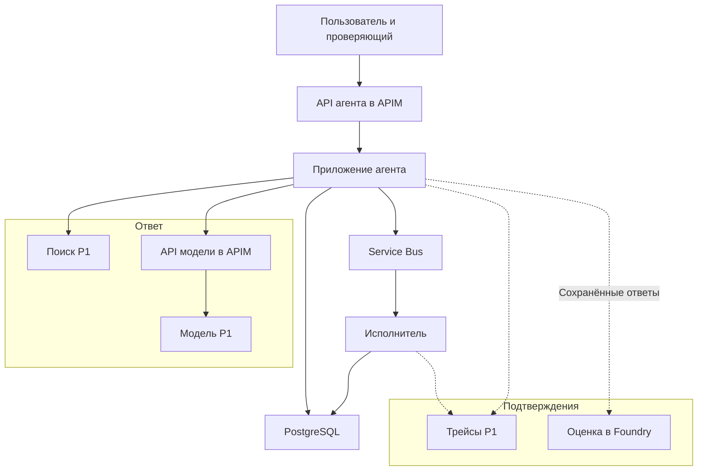

# Агент предлагает публикацию, исполнитель проверяет разрешение

Представь помощника для команды, которая ведёт технические заметки в открытом доступе. На вопросы он отвечает через поиск из P1, а для публикации предлагает вызов `publish_note(noteId, expectedVersion)`. Приложение показывает проверяющему человеку точный текст и место публикации. Опубликовать заметку можно только после одобрения.

Пользователь может уйти и позже вернуться за результатом: PostgreSQL сохраняет решения, а Service Bus передаёт задания на публикацию исполнителю независимо от срока жизни HTTP-запроса. API Management контролирует и входящие обращения к агенту, и обращения агента к модели. Разрешение опубликовать конкретную заметку приложение проверяет отдельно.

**Проверка материала:** использованы актуальные справочники Microsoft Learn и Azure CLI. Развёртывание в действующей подписке не выполнялось: подписки для курса пока нет. Ниже указаны выполненные локальные проверки компиляции. Остальные проверки описывают ожидаемые результаты и критерии приёмки.

:::note[Предварительное условие: P1]

Сначала выполни [руководство по сборке целого RAG-сервиса P1](./rag-service.md). Отдельные упражнения к урокам не заменяют развёрнутый базовый сервис. Выполни проверки ниже на его основе.

:::

## Цель и архитектура \{#goal-and-architecture}

Сохрани развёртывания моделей (model deployments) P1, индекс Search, исходные BLOB-объекты, Key Vault, среду Container Apps (Container Apps environment) и Application Insights. Расширь исходный код приложения P1 и его конфигурацию поставки. В отдельной группе P2, которую затем удалишь, размести API `p2-agent` и отдельный фоновый обработчик `p2-tool-executor`; оба используют существующую среду Container Apps.

Развёрнутый `/ask` из P1 остаётся базовым вариантом для сравнения. Новые приложения добавляют работу агента и исполнителя, используя прежние зависимости.



| Что нужно | Реализация | Откуда продолжить |
|---|---|---|
| Приложение с агентом | Container Apps и Microsoft Agent Framework поверх `IChatClient` | [Агенты в Azure](../part-3-llms-on-azure/agents-on-azure.md#try-it) |
| Диалоги, одобрения и заметки | PostgreSQL Flexible Server и EF Core | [Доступ к данным](../part-2-modern-dotnet/data-access.md#try-it) |
| Отложенное выполнение | Очередь Service Bus и отдельный обработчик на .NET | [Сообщения и события](../part-1-azure-foundations/messaging.md#try-it) |
| Доступ пользователя и доступ к модели | Один экземпляр APIM с двумя определениями API | [AI-шлюз](../part-3-llms-on-azure/ai-gateway.md#try-it) |
| Поиск и конфигурация | Search, Blob Storage и Key Vault из P1 | [Хранение данных](../part-1-azure-foundations/data.md#try-it) и [AI в .NET](../part-2-modern-dotnet/ai-in-dotnet.md#try-it) |
| Подтверждение результатов | Существующая телеметрия и оценка набора данных в Foundry | [Оценка качества и трассировка](../part-3-llms-on-azure/evaluation-and-tracing.md#try-it) |

Токен пользователя определяет, кто может обращаться к агенту. Учётные данные для модели определяют, какое приложение может расходовать её ресурсы. Одобрение публикации конкретной заметки требует отдельной проверки.

## Этапы \{#milestones}

### 1. Сохрани работающий P1 для сравнения \{#1-preserve-a-working-p1-baseline}

Продолжай упражнения [«Инфраструктура как код»](../part-1-azure-foundations/infrastructure-as-code.md#try-it), [«Выбор вычислительной среды»](../part-1-azure-foundations/compute.md#try-it) и [«Конвейеры поставки в Azure»](../part-4-ai-delivery/pipelines-to-azure.md#try-it). Начинай, когда P1 уже отвечает на вопрос со ссылками на источники. Запиши идентификаторы ресурсов, имена развёртываний, версию индекса, дайджест образа и один характерный ответ. Сохрани оповещения об учебном бюджете из [введения](../intro.md#budget).

Для проекта выделена группа `rg-p2-gateway-lab`, как в уроке о шлюзе. Если это имя уже занято другим упражнением, выбери новое и последовательно замени его во всех шагах.

Создай управляемое удостоверение (managed identity) `p2-tool-executor` заново в группе P2 вместо временного варианта из `rg-p2-approval-lab`. Для API создай отдельное удостоверение `p2-agent`. Подключи каждое только к соответствующему приложению. [Создание и подключение удостоверения](https://learn.microsoft.com/ru-ru/cli/azure/identity?view=azure-cli-latest) сами по себе не дают доступа к данным.

В локальный файл `p2-role-assignments.txt` добавляй идентификатор каждого нового назначения роли (role assignment) за пределами группы P2. Для этого у каждого вызова [`az role assignment create`](https://learn.microsoft.com/ru-ru/cli/azure/role/assignment?view=azure-cli-latest) сохраняй результат `--query id --output tsv`. Включи сюда права на поиск и получение образов: этот список понадобится при удалении ресурсов.

**Проверка:** прежний вопрос к P1 по-прежнему получает ответ со ссылками. В списке ресурсов различаются общие зависимости P1 и принадлежащие P2 приложения, удостоверения, база данных и очередь. Ни одна зависимость P1 не создана заново.

### 2. Сохрани запросы и решения в базе данных \{#2-turn-the-local-store-into-a-durable-approval-boundary}

Расширь `P2.Store` с миграцией `InitialAgentStore` из урока [«Доступ к данным»](../part-2-modern-dotnet/data-access.md#try-it). Создай PostgreSQL в группе P2: [Burstable B1ms с выделенными 32 GiB хранения](https://learn.microsoft.com/ru-ru/azure/postgresql/configure-maintain/quickstart-create-server), если такая конфигурация доступна в регионе.

В этом упражнении используется публичная конечная точка. Разреши TCP 5432 только с исходящих IP-адресов обоих приложений. Список [`properties.outboundIpAddresses`](https://learn.microsoft.com/ru-ru/rest/api/resource-manager/containerapps/container-apps/get?view=rest-resource-manager-containerapps-2025-01-01) получи командой `az containerapp show --resource-group rg-p2-gateway-lab --name HOST --query properties.outboundIpAddresses --output tsv`. Для каждого адреса создай [правило брандмауэра PostgreSQL](https://learn.microsoft.com/ru-ru/azure/postgresql/security/security-firewall-rules) с одинаковыми начальным и конечным адресами. После развёртываний повторно считай адреса и исправь правила, если они изменились. Не добавляй широкое правило `0.0.0.0`, разрешающее обращения из сервисов Azure.

Подключайся по FQDN сервера с `SSL Mode=VerifyFull`. По [руководству по управляемым удостоверениям](https://learn.microsoft.com/ru-ru/azure/postgresql/security/security-connect-with-managed-identity) настрой аутентификацию Entra, создай в базе субъекты для обоих удостоверений и выдай им SQL-права. Назначение роли Azure не заменяет права внутри базы.

В каждом приложении создай один источник данных Npgsql с [`UsePeriodicPasswordProvider`](https://www.npgsql.org/doc/security.html). Функция обратного вызова получает токен управляемого удостоверения приложения для `https://ossrdbms-aad.database.windows.net/.default`. Выбери интервал обновления короче срока действия токена и короткий интервал повтора при ошибке. Передавай источник данных в EF; не оставляй в строке подключения токен, полученный один раз при запуске.

Добавь в схему вызывающего пользователя, назначенного проверяющего, время решения, срок действия, идентификатор операции, зафиксированный текст, место публикации и таблицы черновиков и опубликованных заметок. Вместе с диалогом, принадлежащим тенанту (tenant), сохраняй сеанс Agent Framework (Agent Framework session).

Изменять опубликованные заметки и результаты выполнения может только субъект базы данных, которым пользуется исполнитель. API создаёт предложения и сохраняет решения уполномоченного человека, но не имеет SQL-прав на публикацию.

Используй уникальный идентификатор операции и проверки параллельных изменений при смене состояния одобрения. Одобренные данные должны оставаться неизменными. Сгенерируй дополнительную миграцию, проверь её и лишь затем применяй с удостоверением для развёртывания. EF позволяет [подготовить SQL-скрипт для проверки](https://learn.microsoft.com/ru-ru/ef/core/managing-schemas/migrations/applying):

```bash
# In the existing P2.Store directory, after extending the model.
dotnet ef migrations add ApprovalExecution
dotnet ef migrations script --idempotent --output p2-migration.sql
```

**Компиляция:** 19.10.2026 локально собран пример, который расширяет упражнение `P2.Store` по описанной схеме; созданы миграция и идемпотентный SQL-скрипт. Использованы .NET SDK 10.0.402, Npgsql.EntityFrameworkCore.PostgreSQL 10.0.3, Microsoft.EntityFrameworkCore.Design 10.0.13 и dotnet-ef 10.0.13. SQL не применялся; объединённый сервис одобрения не запускался с PostgreSQL или в Azure.

До проверки обработчиков настрой аутентификацию входящих запросов: упражнение по Entra не регистрирует это API.

1. Зарегистрируй приложение `p2-notes-api` для одного тенанта. В манифесте задай [`api.requestedAccessTokenVersion` равным `2`](https://learn.microsoft.com/ru-ru/entra/identity-platform/identifier-uri-restrictions) и [предоставь область разрешений](https://learn.microsoft.com/ru-ru/entra/identity-platform/quickstart-configure-app-expose-web-apis) `api://API_CLIENT_ID/agent.use`.
2. Добавь [роль приложения](https://learn.microsoft.com/ru-ru/entra/identity-platform/howto-add-app-roles-in-apps) `Notes.Reviewer` для пользователей. Назначь её проверяющему для упражнения в разделе Enterprise applications → Users and groups.
3. Создай `p2-notes-cli`, включи [public client flows](https://learn.microsoft.com/ru-ru/entra/identity-platform/scenario-desktop-app-registration), добавь делегированное разрешение этого API и предоставь согласие. Запиши идентификаторы клиентов обоих приложений для последующего удаления.

Имена ниже выбраны приложением, кроме параметров JWT:

| Параметр | Значение и где используется |
|---|---|
| `P2:ReviewerObjectId` | Идентификатор объекта назначенного проверяющего; копируется из серверной конфигурации в каждое предложение |
| `P2:TenantId`, `P2:ApiClientId`, `P2:ClientId` | Идентификатор каталога, идентификатор клиента API и идентификатор клиента CLI; используются API, APIM и клиентом получения токенов |
| Издатель токенов JWT и аудитория (audience) | `https://login.microsoftonline.com/TENANT_ID/v2.0` и GUID клиента API для этих [токенов v2](https://learn.microsoft.com/ru-ru/entra/identity-platform/access-token-claims-reference) |
| База данных | FQDN сервера, база и отдельное имя субъекта для каждого приложения; пароль не хранится |
| Управляемое удостоверение | Идентификатор клиента удостоверения, подключённого к каждому приложению; явно выбирается при получении токена |
| Очередь | FQDN пространства имён и `publish`; API отправляет, исполнитель получает |
| Модель | Базовый URL шлюза, имена развёртываний чата и эмбеддингов, ключ подписки в секрете приложения |

В ASP.NET Core зарегистрируй [`AddAuthentication().AddJwtBearer`](https://learn.microsoft.com/ru-ru/aspnet/core/security/authentication/configure-jwt-bearer-authentication?view=aspnetcore-10.0) с указанными издателем токенов и аудиторией, а также `MapInboundClaims=false`. Размести `UseAuthentication()` и `UseAuthorization()` перед обработчиками.

На каждом маршруте требуй аутентификацию и наличие `agent.use` в значении `scp`, где разрешения разделены пробелами. Для решения об одобрении дополнительно требуй `Notes.Reviewer` в `roles`. Тенант и вызывающего пользователя определяй по проверенным `tid` и `oid`.

Добавлять сообщения в диалог может его владелец. Читать предложение и состояние операции могут владелец или назначенный проверяющий. Принять решение может только назначенный проверяющий. Изменение черновика требует нового предложения.

**Проверка:** после развёртывания обоих приложений проверь подключение к базе и обновление токена по истечении срока действия первого токена. Сначала выполни аутентифицированные запросы из этапа 5 к локальному приложению, заменив модель синтетическим обработчиком предложений. Перезапусти приложение до принятия решения и убедись, что запись ожидающего предложения сохранилась. После отказа опубликованных заметок быть не должно, а запросы из другого тенанта должны отклоняться. Из двух конкурирующих решений должно применяться одно.

### 3. Передавай одобренные задания на публикацию через очередь \{#3-publish-approved-work-through-a-queue}

Адаптируй упражнение [«Сообщения и события»](../part-1-azure-foundations/messaging.md#try-it): его очередь `ingest` готовит P3, а здесь нужна `publish`. Сохрани тариф Basic и блокировку на пять минут. Выполни команды в Bash после выбора подписки, когда группа P2 уже существует. Справочники: [пространство имён](https://learn.microsoft.com/ru-ru/cli/azure/servicebus/namespace?view=azure-cli-latest) и [очередь](https://learn.microsoft.com/ru-ru/cli/azure/servicebus/queue?view=azure-cli-latest).

```bash
p2Group='rg-p2-gateway-lab'
p2Bus="sb-p2-$(date +%s)-$RANDOM"
az servicebus namespace create --resource-group "$p2Group" --name "$p2Bus" \
  --location westeurope --sku Basic --disable-local-auth true --output none
az servicebus queue create --resource-group "$p2Group" --namespace-name "$p2Bus" \
  --name publish --lock-duration PT5M --output none
```

Выдай удостоверению API роль `Azure Service Bus Data Sender`, а удостоверению исполнителя — [`Azure Service Bus Data Receiver`](https://learn.microsoft.com/ru-ru/azure/service-bus-messaging/service-bus-managed-service-identity), обе в области действия (scope) очереди. Не переноси на приложения роль Data Owner, которая выдавалась для ручной работы в Explorer.

При одобрении сохраняй переход состояния и запись об ожидающей отправке в одной транзакции базы данных. Диспетчер в приложении API опрашивает такие записи, отправляет идентификаторы операции и одобрения, затем отмечает отправку. Сбой после отправки, но до отметки может привести к повторной отправке.

В конфигурации развёртывания обоих приложений задай `template.scale.minReplicas: 1`. Иначе [масштабирование по HTTP может уменьшить число реплик до нуля](https://learn.microsoft.com/ru-ru/azure/container-apps/scale-app), а диспетчер должен работать и без входящих запросов. Пока человек принимает решение, не удерживай блокировку сообщения или транзакцию базы. Разделение ответственности за сохранённое состояние разобрано в уроке [«Устойчивые прогоны»](/rag-agents/part-2-agents/durable-runs/).

Исполнитель — обработчик очереди без входящего HTTP-доступа. Используй способ сборки и развёртывания контейнера из P1, но отдельное удостоверение. Задай конечный срок обработки и продлевай блокировку сообщения, когда это необходимо.

Получив сообщение, исполнитель по идентификатору операции загружает записи о её состоянии. Затем заново проверяет тенант, права вызывающего пользователя, проверяющего, срок действия, инструмент, зафиксированные данные и ожидаемую версию заметки. В одной короткой [транзакции базы данных](https://learn.microsoft.com/ru-ru/ef/core/saving/transactions) условно обновляет опубликованную заметку и результат операции. Если операция уже завершилась успешно, возвращает сохранённый результат. Если идентификатор тот же, а данные другие, отклоняет выполнение.

При конкуренции обработчиков или конфликте параллельных изменений перечитай состояние, прежде чем решать, что делать дальше. Повторять запись автоматически нельзя. Такая атомарность относится к публикации внутри PostgreSQL; для внешнего места публикации нужен собственный протокол, безопасный при повторе.

**Проверка:** одобри синтетическое предложение и через API состояния проверь, что заметка опубликована. Останови исполнителя после фиксации транзакции, но до сообщения брокеру об успешной обработке. При [повторной доставке в режиме PeekLock](https://learn.microsoft.com/ru-ru/azure/service-bus-messaging/service-bus-message-loss-and-duplicates) должен возвращаться тот же результат без второго увеличения версии. Сообщать об успешной обработке можно только после фиксации транзакции. Отдельно зафиксируй одобрение, прекрати HTTP-запросы и останови диспетчер до отправки: после перезапуска он должен найти ожидающую запись. Повтори случаи отказа, истёкшего срока и устаревшей версии; некорректные сообщения отправляй в очередь недоставленных сообщений.

### 4. Подключи агента, который запрашивает одобрение \{#4-let-one-agent-request-approval}

Продолжай уроки [«Агенты в Azure»](../part-3-llms-on-azure/agents-on-azure.md#try-it) и [«AI в .NET»](../part-2-modern-dotnet/ai-in-dotnet.md#try-it). Сохрани .NET 10 и закреплённые версии пакетов P1; для [Microsoft.Agents.AI закрепи 1.13.0](https://www.nuget.org/packages/Microsoft.Agents.AI/1.13.0). Фабрика ниже — пример того, как зарегистрировать агента и его инструменты. Передай ей чат-клиент P1, функцию поиска и функцию обратного вызова для публикации, описанную ниже:

```csharp
using Microsoft.Agents.AI;
using Microsoft.Extensions.AI;

public static class NoteAgent
{
    public static AIAgent Create(
        IChatClient chat, AIFunction retrieve, AIFunction publishNote)
        => chat.AsAIAgent(
            name: "NoteAgent",
            instructions: "Answer from retrieved notes with citations. " +
                "Request approval before publishing a note.",
            tools: [retrieve, new ApprovalRequiredAIFunction(publishNote)]);
}
```

**Компиляция:** эта фабрика без изменений собрана 19.10.2026 для `net10.0` с .NET SDK 10.0.402 и Microsoft.Agents.AI 1.13.0; итоговая версия зависимости Microsoft.Extensions.AI — 10.6.0. Проверена только компиляция: шаг агента не выполнялся, вызовов Azure не было.

[Контракт `AsAIAgent`](https://learn.microsoft.com/ru-ru/dotnet/api/microsoft.extensions.ai.chatclientextensions.asaiagent?view=agent-framework-dotnet-latest) позволяет передать показанные инструменты. То, кто исполняет вызов инструмента, разобрано в уроке [«Использование инструментов»](/rag-agents/part-2-agents/tool-use/). Свяжи запрос на одобрение (approval request) из фреймворка с сохранёнными записями приложения:

| Шаг | Что сохраняется или выполняется |
|---|---|
| Агент возвращает `ToolApprovalRequestContent` | Извлеки [`FunctionCallContent.CallId`](https://learn.microsoft.com/ru-ru/dotnet/api/microsoft.extensions.ai.functioncallcontent?view=net-10.0-pp), имя функции и точные аргументы. Определи и зафиксируй текст, место публикации и версию. Атомарно сохрани снимок сеанса, сериализованный запрос, новые идентификаторы предложения и операции. Уникальный ключ — тенант, диалог и идентификатор вызова. Возвращай идентификаторы приложения; флаг одобрения от модели не принимай. |
| Обработчик решения | Проверь ревизию ожидающего предложения, тенант, владельца, назначенного проверяющего, данные и срок действия. В одной транзакции сохрани одобрение или отказ. Только при одобрении добавь уникальную запись об ожидающей отправке. Только при этом переходе создаётся запись для отправки задания, в том числе при использовании синтетического обработчика из этапа 3. |
| Продолжение Agent Framework | Для продолжения восстанови сохранённый запрос и тот же сеанс. Помести `request.CreateResponse(approved)` в пользовательское `ChatMessage`, затем вызови `agent.RunAsync(message, session)`. Сохрани состояние после продолжения. При повторе после сбоя исключи одновременное продолжение одного диалога. |
| Функция обратного вызова для публикации после продолжения | В этой функции свяжи контекст выполнения с сохранёнными идентификаторами вызова и операции. Сравни аргументы, загрузи одобренную запись и верни идентификатор и состояние операции. Функция не отправляет задание в очередь и не публикует заметку. Повторный вызов возвращает ту же операцию. |

[Документированный цикл](https://learn.microsoft.com/ru-ru/agent-framework/agents/tools/tool-approval) предоставляет механизм ответа фреймворку. Описанное сопоставление с записями приложения позволяет сохранить этот порядок после перезапуска. После каждого запуска ищи следующие запросы на одобрение и сохраняй каждый до показа полного текста и места публикации человеку. Сохраняй [данные сеанса](https://learn.microsoft.com/ru-ru/agent-framework/concepts/agents/conversations/session) так, чтобы сеанс можно было восстановить после перезапуска. Ограничь число итераций и передавай сигнал отмены дальше, сохраняя уже зафиксированные данные.

**Проверка:** вопрос, который требует только чтения, получает ответ со ссылками. Просьба о публикации создаёт ожидающее предложение без добавления записи в таблицу опубликованных заметок. После перезапуска API отклони предложение — публикации быть не должно. Создай новое, одобри и получи сохранённый результат исполнителя. Если после одобрения аргументы изменились, выполнение должно быть запрещено.

### 5. Настрой оба API шлюза \{#5-enforce-both-gateway-paths}

Продолжай уроки [«AI-шлюз»](../part-3-llms-on-azure/ai-gateway.md#try-it) и [«Удостоверения I — Microsoft Entra ID»](../part-1-azure-foundations/entra-id.md#try-it). Разверни `gateway.bicep` как `gateway` в группе P2. Используй развёртывание чат-модели P1 и подписку агента P2 с областью действия одного API. Новое назначение роли удостоверению APIM на ресурсе модели добавь в список для удаления.

В качестве базового URL модели задай выходное значение `apiBaseUrl`. Транспорт должен отправлять `Ocp-Apim-Subscription-Key`, сохранённый в секрете приложения P2. APIM удаляет эти учётные данные подписки и [аутентифицируется перед серверной частью собственным управляемым удостоверением](https://learn.microsoft.com/ru-ru/azure/api-management/api-management-authenticate-authorize-ai-apis). Удостоверению агента не нужны прямые права на модель или её ключ.

Добавь в `p2-model` операцию `POST /embeddings` с той же серверной частью v1. Адаптер эмбеддингов переведи на тот же базовый URL и ключ шлюза. Перемести `llm-token-limit` с уровня API на операцию чата; удаление учётных данных и аутентификацию серверной части оставь на уровне API. В [документации политики токенов](https://learn.microsoft.com/ru-ru/azure/api-management/llm-token-limit-policy) описаны схемы Chat Completions и Responses; эмбеддинги в этот перечень не входят. Расход эмбеддингов учитывай отдельно.

Общий лимит в 50 токенов предназначен только для отдельной проверки ограничения частоты. Перед проверкой полного шага агента явно выдели больший лимит.

Добавь `p2-agent-api` по пути `/agent`, сопоставив его маршруты с серверной частью. Отключи для входящего API аутентификацию ключом подписки. В именованных значениях APIM задай `p2-tenant-id` и `p2-api-client-id` из этапа 2. Вставь [политику входящих запросов](https://learn.microsoft.com/ru-ru/azure/api-management/validate-azure-ad-token-policy) в `<inbound>` после `<base />`:

```xml
<validate-azure-ad-token tenant-id="{{p2-tenant-id}}" header-name="Authorization"
    failed-validation-httpcode="401">
  <audiences><audience>{{p2-api-client-id}}</audience></audiences>
  <required-claims>
    <claim name="scp" match="all" separator=" "><value>agent.use</value></claim>
  </required-claims>
</validate-azure-ad-token>
```

Передавай bearer-токен в API без изменений. Само API повторно проверяет его и применяет проверки этапа 2. [Ключ подписки подтверждает владение ключом](https://learn.microsoft.com/ru-ru/azure/api-management/api-management-subscriptions); удостоверение пользователя проверяется по токену.

Через `p2-notes-cli` и [MSAL device-code flow](https://learn.microsoft.com/ru-ru/dotnet/api/microsoft.identity.client.publicclientapplication.acquiretokenwithdevicecode?view=msal-dotnet-latest) получи отдельные токены вызывающего пользователя и проверяющего. Создай клиент выражением `PublicClientApplicationBuilder.Create(ClientId).WithTenantId(TenantId).Build()` и вызови `AcquireTokenWithDeviceCode(["api://API_CLIENT_ID/agent.use"], callback).ExecuteAsync()`. Функция обратного вызова показывает `DeviceCodeResult.Message`; значения `AccessToken` из двух результатов запиши в соответствующие переменные оболочки. Во второй раз войди под учётной записью назначенного проверяющего. Аудитория токена — это API; токен управления из Azure CLI для него не подходит.

Маршруты ниже — контракт приложения:

| Маршрут | Данные и результат |
|---|---|
| `POST /conversations` | Создаёт диалог, принадлежащий тенанту и вызывающему пользователю; возвращает `id` |
| `POST /conversations/{id}/turns` | Принимает `text`; возвращает ответ либо ожидающее предложение: `proposalId`, `revision`, `operationId`, зафиксированный текст, место публикации и срок действия |
| `GET /proposals/{id}` | Владелец или назначенный проверяющий читает сохранённое предложение, строковую `revision` и срок действия |
| `POST /proposals/{id}/decision` | Принимает только `revision` и логическое `approve`; проверяет проверяющего и атомарно меняет состояние; возвращает `operationId` и состояние. Устаревшее или конфликтующее решение получает `409` |
| `GET /operations/{id}` | Уполномоченный владелец или проверяющий получает состояние `pending`, `denied`, `queued`, `succeeded` или `failed` и сохранённый результат |

Добавь черновик `lab-note` версии 1 и укажи проверяющего в серверной конфигурации. Для проверки нужны `curl` и `jq`. На этапах 2–4 используй локальный `base`. В `callerToken` и `reviewerToken` должны быть результаты двух входов через MSAL; не записывай токены в журналы. Перед отправкой одобрения проверь текст, место публикации и `expiresAt`:

```bash
set -euo pipefail
base='https://YOUR_GATEWAY.azure-api.net/agent'
# Set callerToken and reviewerToken from the two MSAL results; do not log them.
conversation=$(curl --fail-with-body -sS -X POST "$base/conversations" \
  -H "Authorization: Bearer $callerToken" | jq -er .id)
proposal=$(curl --fail-with-body -sS "$base/conversations/$conversation/turns" \
  -H "Authorization: Bearer $callerToken" -H 'Content-Type: application/json' \
  --data '{"text":"Propose publishing note lab-note at version 1."}')
proposalId=$(jq -er .proposalId <<< "$proposal")
operationId=$(jq -er .operationId <<< "$proposal")
proposal=$(curl --fail-with-body -sS "$base/proposals/$proposalId" \
  -H "Authorization: Bearer $reviewerToken")
revision=$(jq -er .revision <<< "$proposal")
jq '{text,destination,expiresAt}' <<< "$proposal" # Reviewer inspects the frozen payload.
# Submit only after that inspection; use false to test denial on a fresh proposal.
curl --fail-with-body -sS "$base/proposals/$proposalId/decision" \
  -H "Authorization: Bearer $reviewerToken" -H 'Content-Type: application/json' \
  --data "$(jq -n --arg revision "$revision" '{revision:$revision,approve:true}')"
curl --fail-with-body -sS "$base/operations/$operationId" \
  -H "Authorization: Bearer $callerToken"
```

На странице обзора классического APIM тарифа Developer найди его [выделенные публичные IPv4-адреса](https://learn.microsoft.com/ru-ru/azure/api-management/api-management-howto-ip-addresses). Разреши входящий доступ к `p2-agent` только с них: добавь по [разрешающему правилу](https://learn.microsoft.com/ru-ru/azure/container-apps/ip-restrictions) `/32` для каждого адреса и удали посторонние разрешения. Сохрани ограничения в определении инфраструктуры. Семантическое кэширование в этом проекте отключено.

**Проверка:** через `/agent` уполномоченный пользователь с корректным токеном может получить ответ и одобрить публикацию. Без токена или с другой аудиторией запрос отклоняется до обработчика. Прямой URL Container App с рабочей станции недоступен. Обращение к `/model` без ключа даёт `401`; при исчерпании выделенного лимита частоты — `429` с `Retry-After`. Фиксированное число успешных запросов не гарантируется. После перевода обоих клиентов, чата и эмбеддингов, задай вопрос со ссылками на источники, чтобы обнаружить нарушение работы поиска.

### 6. Сохрани подтверждения и оцени ответы \{#6-capture-evidence-and-evaluate-saved-answers}

Продолжай уроки [«Оценка качества и трассировка»](../part-3-llms-on-azure/evaluation-and-tracing.md#try-it) и [«Безопасный выпуск изменений»](../part-4-ai-delivery/releasing-safely.md#try-it). Отправляй телеметрию туда же, куда P1, и используй `P1.ModelCalls`. Связывай записи API, диспетчера и исполнителя по идентификатору операции. Не включай исходный текст заметок в обычную телеметрию. Проверки выполнения приложения запускай отдельно от оценки качества ответов.

Создай временный дочерний проект `p2-evaluation` в существующем ресурсе Foundry через [CLI проектов](https://learn.microsoft.com/ru-ru/cli/azure/cognitiveservices/account/project?view=azure-cli-latest). Если имя уже занято, выбери другое и измени его также в скрипте удаления:

```bash
az cognitiveservices account project create \
  --resource-group 'YOUR_P1_FOUNDRY_GROUP' --name 'YOUR_P1_FOUNDRY_ACCOUNT' \
  --project-name p2-evaluation --location westeurope --output none
```

Используй существующее развёртывание модели-судьи и [необходимые разрешения](https://learn.microsoft.com/ru-ru/azure/foundry/observability/how-to/evaluation-permissions). Права только на проект не дают права вызывать модель-судью на уровне ресурса Foundry. Дочерний проект позволяет отдельно удалить загруженный набор данных P2 и его запуск оценки.

Сохрани пять ответов: на обычный вопрос, на вопрос без ответа в источниках, на вопрос с ложной предпосылкой, итоговый ответ после отказа в публикации и итоговый ответ после одобрения. Для каждого запиши `query`, `response`, точный контекст поиска `context`, идентификатор случая и идентификатор трейса.

В [портале оценки](https://learn.microsoft.com/ru-ru/azure/foundry/how-to/evaluate-generative-ai-app) выбери Dataset и Individual turns, сопоставь поля и оставь только критерии Groundedness и Relevance. Назови запуск `p2-baseline`. Сохрани конфигурацию и результаты каждого случая вместе с отдельными проверками выполнения.

**Проверка:** успешный запуск оценки имеет статус Completed. При Partial выясни причины ошибок средств оценки. Просмотри каждый ответ и трейс. Хорошая оценка модели не доказывает, что отклонённая операция ничего не записала: проверь результаты непосредственно в базе. Эти пять проверок показывают, как компоненты работают вместе, но не подтверждают качество для промышленной эксплуатации.

## Стоимость \{#cost}

Планируй короткую практическую работу. Учебный ориентир в 10 долларов США в месяц не означает, что весь набор сервисов укладывается в эту сумму при постоянной работе. Шлюз Developer и оба приложения с минимум одной репликой могут тарифицироваться и в простое. До создания ресурсов проверь цены региона, после работы удали расширение P2.

| Ресурс | Конфигурация | Единица оплаты | Бесплатные предложения и ограничения | От чего зависит счёт |
|---|---|---|---|---|
| [APIM](https://azure.microsoft.com/en-us/pricing/details/api-management/) | Developer, одна единица | Время работы единицы | При расчёте не учитывай бесплатный объём для Developer; SLA для промышленной эксплуатации нет | Всё время существования, включая простой |
| [Container Apps](https://azure.microsoft.com/en-us/pricing/details/container-apps/) | Consumption, агент и исполнитель | vCPU-секунды, GiB-секунды и запросы | В месяц на подписку: 180 000 vCPU-секунд, 360 000 GiB-секунд и 2 миллиона запросов; общий объём с P1 | Ресурсы при работе и простое; у каждого приложения минимум одна реплика |
| [PostgreSQL](https://azure.microsoft.com/en-us/pricing/details/postgresql/flexible-server/) | Burstable B1ms, выделенные 32 GiB | Время вычислений, хранение и превышение объёма резервных копий в GiB-месяцах | Для [новых учётных записей, соответствующих условиям](https://azure.microsoft.com/en-us/pricing/purchase-options/azure-account): 750 часов, 32 GB хранения и 32 GB резервных копий в месяц на 12 месяцев; в предложении указаны GB, а для расчёта платы используются GiB | Время существования сервера, сохраняемые данные и соответствие условиям предложения |
| [Service Bus](https://azure.microsoft.com/en-us/pricing/details/service-bus/) | Basic | Операции обмена сообщениями | При расчёте не учитывай бесплатный объём для Basic; почасовой базовой платы Standard нет | Отправка, получение, сообщение брокеру результата обработки и повторы |
| [Модели P1](https://azure.microsoft.com/en-us/pricing/details/azure-openai/) | Существующие типы развёртываний | Входные и выходные токены по тарифу модели | При расчёте не учитывай общий бесплатный объём инференса | Вызовы чата, эмбеддингов и модели-судьи |
| [Оценка в Foundry](https://azure.microsoft.com/en-us/pricing/details/foundryobservability/) | Оценка качества по набору данных | Токены выбранной модели-судьи | Доплаты за этот способ оценки качества нет; инференс оплачивается | Размер набора, контекст и критерии |
| [Телеметрия P1](https://azure.microsoft.com/en-us/pricing/details/monitor/) | Application Insights и Analytics Logs | Принятые GB и платное хранение | Для этого уровня журналов — первые 5 GB в месяц на каждую учётную запись для выставления счетов | Дополнительные спаны, журналы и срок хранения |
| [Search из P1](https://azure.microsoft.com/en-us/pricing/details/search/) | Существующий выделенный тариф | Время работы единиц поиска платного тарифа | [Free](https://learn.microsoft.com/ru-ru/azure/search/search-limits-quotas-capacity): один сервис на подписку и 50 MB; P2 не получает второй бесплатный объём | Уже выделенная мощность; дополнительные функции тарифицируются отдельно |
| [Blob Storage из P1](https://azure.microsoft.com/en-us/pricing/details/storage/blobs/) | Существующая учётная запись хранения (storage account) и уровень доступа | GB-месяцы хранения и операции; передача и извлечение данных — когда за них взимается плата | При расчёте не закладывай конкретный бесплатный объём для учётной записи хранения | Сохранённые исходные документы и чтение |
| [Key Vault из P1](https://azure.microsoft.com/en-us/pricing/details/key-vault/) | Существующий Standard | Операции с секретами за 10 000 транзакций | При расчёте не учитывай новый бесплатный объём | Обращения P1 к секретам; P2 не добавляет секретов в хранилище |
| [Реестр P1](https://azure.microsoft.com/en-us/pricing/details/container-registry/) | Существующий тариф | Время работы реестра и превышение объёма хранения; передача данных — когда за неё взимается плата | Для [новых учётных записей, соответствующих условиям](https://azure.microsoft.com/en-us/pricing/purchase-options/azure-account): один реестр Standard и 100 GB на 12 месяцев | Два дополнительных репозитория образов; второй реестр не создаётся |

За ресурсы P1 по-прежнему начисляется плата, а условия их бесплатного использования остаются прежними. P2 не создаёт им замену. Удаление ресурсов P1 отложи до завершения всей практической работы курса. При удалении P2 сохрани работающий базовый сервис.

## Удаление ресурсов \{#teardown}

Прекрати запросы и отправку заданий, дождись оценки или отмени её, затем выгрузи нужные подтверждения результатов. Для образов двух приложений используй отдельные репозитории `p2-agent-lab` и `p2-executor-lab` в реестре P1. Секреты P2 хранятся в приложениях P2.

Дочерний проект оценки, назначения ролей за пределами группы и две регистрации Entra удаляются отдельно; остальные новые ресурсы Azure находятся в группе P2. Запусти Bash-скрипт из каталога с файлом назначений ролей. Замени заполнители, а в `gatewayName` укажи имя из выходных данных развёртывания шлюза.

Скрипт использует команды удаления [группы](https://learn.microsoft.com/ru-ru/cli/azure/group?view=azure-cli-latest), [ролей](https://learn.microsoft.com/ru-ru/cli/azure/role/assignment?view=azure-cli-latest), [проекта](https://learn.microsoft.com/ru-ru/cli/azure/cognitiveservices/account/project?view=azure-cli-latest), [восстановимого APIM](https://learn.microsoft.com/ru-ru/azure/api-management/soft-delete), [репозиториев](https://learn.microsoft.com/ru-ru/cli/azure/acr/repository?view=azure-cli-latest) и [приложений](https://learn.microsoft.com/ru-ru/cli/azure/ad/app?view=azure-cli-latest). Он удаляет только записанные объекты P2. Для классического APIM окончательно удаляется только шлюз этого упражнения; в репозиториях удаляются также слои, не используемые другими образами.

Ошибка удаления, ошибка повторного чтения или неожиданный оставшийся ресурс означают неуспешное завершение. Пустой ответ из-за ошибки не подтверждает отсутствие ресурса. Если файл назначений ролей отсутствует, проверь области действия P1 на оставшиеся права P2.

```bash
set -u
az account set --subscription 'YOUR_SUBSCRIPTION_ID' || exit 1
p2Group='rg-p2-gateway-lab'
p1FoundryGroup='YOUR_P1_FOUNDRY_GROUP'
p1FoundryAccount='YOUR_P1_FOUNDRY_ACCOUNT'
p1Registry='YOUR_P1_REGISTRY_NAME'
gatewayName='YOUR_P2_GATEWAY_NAME'
p2ApiClientId='YOUR_P2_API_CLIENT_ID'
p2ClientId='YOUR_P2_CLI_CLIENT_ID'
failed=0

check_readback() {
  local expected="$1" label="$2" actual
  shift 2
  if actual=$("$@"); then
    if [ "$actual" != "$expected" ]; then
      printf 'Unexpected remaining resource: %s (%s)\n' "$label" "$actual" >&2
      failed=1
    fi
  else
    printf 'Readback failed: %s\n' "$label" >&2
    failed=1
  fi
}

az cognitiveservices account project delete --resource-group "$p1FoundryGroup" \
  --name "$p1FoundryAccount" --project-name p2-evaluation || failed=1

if [ -f p2-role-assignments.txt ]; then
  while IFS= read -r assignmentId || [ -n "$assignmentId" ]; do
    [ -z "$assignmentId" ] && continue
    az role assignment delete --ids "$assignmentId" || failed=1
  done < p2-role-assignments.txt
else
  printf 'Missing role inventory: inspect P1 scopes for P2 grants.\n' >&2
  failed=1
fi

az group delete --name "$p2Group" --yes || failed=1
# Classic APIM retains a recoverable service after deletion; purge only this lab.
az apim deletedservice purge --service-name "$gatewayName" \
  --location westeurope || failed=1
for imageRepository in p2-agent-lab p2-executor-lab; do
  az acr repository delete --name "$p1Registry" \
    --repository "$imageRepository" --yes || failed=1
done
for appId in "$p2ApiClientId" "$p2ClientId"; do
  az ad app delete --id "$appId" || failed=1
  check_readback 0 "Entra app $appId" az ad app list \
    --filter "appId eq '$appId'" --query 'length(@)' --output tsv
done
check_readback false 'P2 group' az group exists --name "$p2Group" --output tsv
check_readback 0 'evaluation project' az cognitiveservices account project list \
  --resource-group "$p1FoundryGroup" --name "$p1FoundryAccount" \
  --query "length([?name=='p2-evaluation' || ends_with(name, '/p2-evaluation')])" --output tsv
check_readback 0 'deleted gateway' az apim deletedservice list \
  --query "length([?name=='$gatewayName'])" --output tsv
check_readback 0 'P2 image repositories' az acr repository list --name "$p1Registry" \
  --query "length([?@=='p2-agent-lab' || @=='p2-executor-lab'])" --output tsv
if [ -f p2-role-assignments.txt ]; then
  while IFS= read -r assignmentId || [ -n "$assignmentId" ]; do
    [ -z "$assignmentId" ] && continue
    check_readback 0 "$assignmentId" az role assignment list --all \
      --fill-principal-name false --fill-role-definition-name false \
      --query "length([?id=='$assignmentId'])" --output tsv
  done < p2-role-assignments.txt
fi
exit "$failed"
```

Удаление завершено успешно, если проверка существования группы возвращает `false`, а проверки проекта оценки, удалённых шлюзов, идентификаторов назначений ролей, репозиториев образов и приложений Entra — ноль совпадений. Разбери все ошибки до удаления списка ресурсов. Сначала выгрузи подтверждения результатов, затем удаляй локальные тестовые данные и учётные данные.

Телеметрия в P1 сохраняется по своей политике хранения; скрипт её не стирает. Проверь, что исходный вопрос к P1 по-прежнему получает ответ со ссылками.

## Что ты сможешь объяснить \{#what-you-can-explain-afterwards}

- Почему аутентификация пользователя, доступ к модели и одобрение вызова инструмента требуют разных проверок?
- Какое удостоверение имеет право публиковать? Как [превратить инструкцию в обязательную проверку](/ai-sdlc/part-1-foundation/rules-that-hold)?
- Как сохранить связь одобрения с тенантом, проверяющим, точными данными, версией и сроком действия после перезапуска?
- Что произойдёт, если транзакция базы зафиксирована, а об успешной обработке сообщения Service Bus ещё не сообщено?
- Чем [подавление повторных отправок брокером](https://learn.microsoft.com/ru-ru/azure/service-bus-messaging/duplicate-detection) отличается от идемпотентности (idempotency) исполнителя при повторной доставке после фиксации транзакции, но до сообщения брокеру об успешной обработке?
- Как внешнее место публикации изменит транзакции и восстановление после сбоя?
- Почему лимиты токенов и оповещения о бюджете не гарантируют точный верхний предел расходов в валюте?
- Какие ошибки обнаруживает оценка качества в Foundry, а какие требуют проверки состояния выполнения?

## Источники \{#sources}

Проверено на 19.10.2026.

- [Agent construction API](https://learn.microsoft.com/ru-ru/dotnet/api/microsoft.extensions.ai.chatclientextensions.asaiagent?view=agent-framework-dotnet-latest), [tool approvals](https://learn.microsoft.com/ru-ru/agent-framework/agents/tools/tool-approval), [invoker responsibility](https://learn.microsoft.com/ru-ru/dotnet/api/microsoft.extensions.ai.approvalrequiredaifunction?view=net-10.0-pp), [sessions](https://learn.microsoft.com/ru-ru/agent-framework/concepts/agents/conversations/session), [function-call identity](https://learn.microsoft.com/ru-ru/dotnet/api/microsoft.extensions.ai.functioncallcontent?view=net-10.0-pp)
- [EF migrations](https://learn.microsoft.com/ru-ru/ef/core/managing-schemas/migrations/applying), [transactions](https://learn.microsoft.com/ru-ru/ef/core/saving/transactions), [concurrency](https://learn.microsoft.com/ru-ru/ef/core/saving/concurrency)
- [Incoming API registration](https://learn.microsoft.com/ru-ru/entra/identity-platform/quickstart-configure-app-expose-web-apis), [delegated client permission](https://learn.microsoft.com/ru-ru/entra/identity-platform/quickstart-configure-app-access-web-apis), [reviewer roles](https://learn.microsoft.com/ru-ru/entra/identity-platform/howto-add-app-roles-in-apps), [public client configuration](https://learn.microsoft.com/ru-ru/entra/identity-platform/scenario-desktop-app-registration), [token version configuration](https://learn.microsoft.com/ru-ru/entra/identity-platform/identifier-uri-restrictions), [access-token claims](https://learn.microsoft.com/ru-ru/entra/identity-platform/access-token-claims-reference), [JWT bearer validation](https://learn.microsoft.com/ru-ru/aspnet/core/security/authentication/configure-jwt-bearer-authentication?view=aspnetcore-10.0), [MSAL device code](https://learn.microsoft.com/ru-ru/dotnet/api/microsoft.identity.client.publicclientapplication.acquiretokenwithdevicecode?view=msal-dotnet-latest)
- [Npgsql token rotation and TLS](https://www.npgsql.org/doc/security.html), [PostgreSQL firewall](https://learn.microsoft.com/ru-ru/azure/postgresql/security/security-firewall-rules), [Container App network properties](https://learn.microsoft.com/ru-ru/rest/api/resource-manager/containerapps/container-apps/get?view=rest-resource-manager-containerapps-2025-01-01), [scaling](https://learn.microsoft.com/ru-ru/azure/container-apps/scale-app), [application registration CLI](https://learn.microsoft.com/ru-ru/cli/azure/ad/app?view=azure-cli-latest)
- [PostgreSQL creation](https://learn.microsoft.com/ru-ru/azure/postgresql/configure-maintain/quickstart-create-server), [managed-identity access](https://learn.microsoft.com/ru-ru/azure/postgresql/security/security-connect-with-managed-identity)
- [Service Bus identity](https://learn.microsoft.com/ru-ru/azure/service-bus-messaging/service-bus-managed-service-identity), [delivery and duplicate processing](https://learn.microsoft.com/ru-ru/azure/service-bus-messaging/service-bus-message-loss-and-duplicates)
- [APIM token limits](https://learn.microsoft.com/ru-ru/azure/api-management/llm-token-limit-policy), [subscriptions](https://learn.microsoft.com/ru-ru/azure/api-management/api-management-subscriptions), [backend authentication](https://learn.microsoft.com/ru-ru/azure/api-management/api-management-authenticate-authorize-ai-apis), [Entra validation](https://learn.microsoft.com/ru-ru/azure/api-management/validate-azure-ad-token-policy), [IP addresses](https://learn.microsoft.com/ru-ru/azure/api-management/api-management-howto-ip-addresses), [soft delete](https://learn.microsoft.com/ru-ru/azure/api-management/soft-delete)
- [Container Apps identities](https://learn.microsoft.com/ru-ru/azure/container-apps/managed-identity), [IP restrictions](https://learn.microsoft.com/ru-ru/azure/container-apps/ip-restrictions)
- [Foundry evaluations](https://learn.microsoft.com/ru-ru/azure/foundry/how-to/evaluate-generative-ai-app), [datasets](https://learn.microsoft.com/ru-ru/azure/foundry/observability/how-to/evaluation-datasets), [permissions](https://learn.microsoft.com/ru-ru/azure/foundry/observability/how-to/evaluation-permissions)
- Azure CLI: [groups](https://learn.microsoft.com/ru-ru/cli/azure/group?view=azure-cli-latest), [identities](https://learn.microsoft.com/ru-ru/cli/azure/identity?view=azure-cli-latest), [role assignments](https://learn.microsoft.com/ru-ru/cli/azure/role/assignment?view=azure-cli-latest), [Service Bus namespace](https://learn.microsoft.com/ru-ru/cli/azure/servicebus/namespace?view=azure-cli-latest), [queue](https://learn.microsoft.com/ru-ru/cli/azure/servicebus/queue?view=azure-cli-latest), [Foundry project](https://learn.microsoft.com/ru-ru/cli/azure/cognitiveservices/account/project?view=azure-cli-latest), [APIM](https://learn.microsoft.com/ru-ru/cli/azure/apim?view=azure-cli-latest), [image repositories](https://learn.microsoft.com/ru-ru/cli/azure/acr/repository?view=azure-cli-latest)
