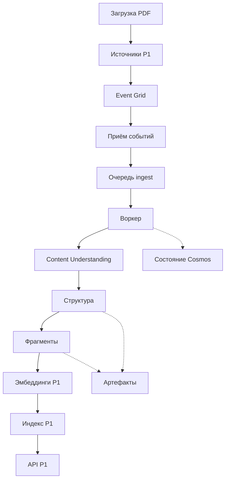

# Преврати загруженные документы в доступные для поиска фрагменты со ссылками на источник

В необязательном проекте P3 ты соберёшь конвейер приёма документов (ingestion pipeline) для RAG-сервиса P1. Документ поступает в существующий контейнер `sources` проекта P1. Конвейер извлекает его структуру, создаёт фрагменты (chunks) и эмбеддинги, затем обновляет тот же индекс, по которому ищет P1. После этого P1 должен отвечать на вопросы о новом документе со ссылкой на него. Ход фонового задания сохраняется в Cosmos DB, чтобы после прерывания обработку можно было продолжить.

Инструкции сверены с Microsoft Learn и справочником Azure CLI. Подписки Azure для их выполнения не было; развёртывание в Azure не проверялось. Иллюстративный фрагмент C# собран и запущен в локальном тестовом приложении с .NET SDK 10.0.402 и средой выполнения .NET 10.0.13; проверено 19.10.2026. Пакеты NuGet ему не нужны. Все проверки ниже описывают ожидаемый результат, который ещё предстоит получить при развёртывании.

:::caution[Развёртывание заблокировано до готовности P1]

Руководство по сборке единого RAG-сервиса P1 пока недоступно. Отдельные упражнения курса не дают готовый P1. Не развёртывай P3, пока P1 не предоставит всё, что перечислено ниже: этот проект дополняет уже работающий сервис.

:::

## Цель и архитектура \{#goal-and-architecture}

Учебная реализация принимает только неизменяемые файлы: каждой версии документа назначай новый путь блоба. Пока воркер (worker) читает файл, перезаписывать его нельзя. Начни с одного небольшого PDF из открытого источника, чтобы результат извлечения можно было проверить вручную.

До первого этапа получи сведения о ресурсах [P1](./overview.md) и проверь необходимые права доступа по таблице ниже:

| Что предоставляет P1 | Что нужно P3 |
|---|---|
| Blob Storage | Идентификатор ресурса, регион, имя учётной записи хранения (storage account), закрытый контейнер `sources` и включённый доступ к данным через Entra. |
| Azure AI Search | Идентификатор ресурса, конечная точка, имя индекса; ключ `id`, поля `title`, `content`, `sourceUrl`, `contentVector`; размерность векторов модели P1 и конфигурация поиска по запросу. |
| Развёртывание модели эмбеддингов | Идентификатор ресурса, конечная точка, имя развёртывания, модель, версия и размерность. Настройки для фрагментов должны совпадать с настройками для запросов. |
| API сервиса | URL, способ аутентификации и запрос по существующим документам, который возвращает ответ со ссылками на источник и страницу. |
| Удостоверения и права | Удостоверение, которое действительно использует API, его существующие права чтения и возможность выдать отдельному удостоверению P3 права записи. |



| Компонент | Средства | Какое упражнение продолжить |
|---|---|---|
| Исходные документы и промежуточные результаты | Существующий Blob Storage и отдельные контейнеры P3 | [Хранение данных](../part-1-azure-foundations/data.md#try-it) |
| Уведомления и надёжное хранение команд | Event Grid, Functions с изолированным рабочим процессом и очередь Service Bus `ingest` | [Сообщения и события](../part-1-azure-foundations/messaging.md#try-it), [Выбор вычислительной среды](../part-1-azure-foundations/compute.md#try-it) |
| Извлечение и разбиение | Content Understanding и твой код разбиения с учётом структуры | [Приём документов](../part-3-llms-on-azure/document-ingestion.md#try-it) |
| Ход обработки | Cosmos DB for NoSQL с условными обновлениями | [Хранение данных](../part-1-azure-foundations/data.md#try-it) |
| Обновление поискового индекса | Развёртывание эмбеддингов P1 и push API Azure AI Search | [RAG на Azure AI Search](../part-3-llms-on-azure/rag-on-ai-search.md#try-it) |
| Развёртывание и подтверждение результата | Описание инфраструктуры P3 и Application Insights | [Инфраструктура как код](../part-1-azure-foundations/infrastructure-as-code.md#try-it), [Наблюдаемость](../part-1-azure-foundations/observability.md#try-it) |

## Этапы сборки \{#milestones}

### 1. Подключи P3 к P1, сохранив существующие ресурсы P1

Продолжи блоки «Попробуй» в уроках о [данных](../part-1-azure-foundations/data.md#try-it), [вычислениях](../part-1-azure-foundations/compute.md#try-it) и [инфраструктуре как коде](../part-1-azure-foundations/infrastructure-as-code.md#try-it). Проверь, что P1 предоставляет всё из таблицы выше. Учебный пример Search с вектором размерности три не подходит для векторов модели, используемой в P1. Удостоверение API должно быть тем, с которым работает P1; два временных удостоверения из упражнений его не заменяют.

Понадобятся Bash, Azure CLI, установленные `curl` и `jq`. Подставь свои значения вместо заполнителей в угловых скобках. Локальную конфигурацию и списки для удаления ресурсов храни вне публикуемого набора документов.

```bash
set -euo pipefail
az account set --subscription '<subscription-id>'
p3_suffix="$(date +%s)-$RANDOM"
p3_group="rg-p3-ingestion-$p3_suffix"
region='<supported-functions-and-content-understanding-region>'
p1_group='<existing-storage-resource-group>'
p1_storage='<existing-storage-account-name>'
p1_storage_id='<existing-storage-resource-id>'
search_endpoint='https://<existing-search-service>.search.windows.net'
search_index='<existing-real-vector-index>'
p3_prefix="p3/$p3_suffix/"
p3_subscription="p3-$p3_suffix"
p3_owns_topic=0
p3_topic=''
az group create --name "$p3_group" --location "$region" --output none
mkdir -p p3-local
: > p3-local/shared-role-ids.txt
: > p3-local/operator-role-ids.txt
for setting in p3_group region p1_group p1_storage p1_storage_id \
  search_endpoint search_index p3_prefix p3_subscription p3_owns_topic p3_topic; do
  printf '%s=%q\n' "$setting" "${!setting}"
done > p3-local/environment.sh
```

По [руководству Functions с доступом без ключей](https://learn.microsoft.com/ru-ru/azure/azure-functions/create-first-function-cli-csharp) создай в группе P3 приложение Flex Consumption: .NET 10 с изолированным рабочим процессом, назначаемое пользователем удостоверение для хранения, хранилище для среды выполнения и развёртывания, ноль постоянно готовых экземпляров. Для обработки документов подключи отдельное назначаемое пользователем удостоверение приложения и явно выбирай его в клиентах Azure. Сохрани настройки доступа через удостоверение и роли для хранилища среды выполнения из руководства: одного доступа к хранилищу развёртывания недостаточно для настройки `AzureWebJobsStorage`. Поддержку среды выполнения и выбор региона проверь в документации по [изолированному рабочему процессу](https://learn.microsoft.com/ru-ru/azure/azure-functions/dotnet-isolated-process-guide) и [настройке Flex Consumption](https://learn.microsoft.com/ru-ru/azure/azure-functions/flex-consumption-how-to).

Для хранилища P3 используй StorageV2, `Standard_LRS`, уровень Hot и закрытые контейнеры `artifacts` и `deadletter`. Анонимный доступ и доступ через Shared Key оставь отключёнными. Application Insights и его рабочая область из руководства должны быть единственным местом приёма телеметрии P3; к ним применяются настройки сбора и хранения из урока о наблюдаемости. Все новые ресурсы внеси в описание инфраструктуры P3, не копируя развёртывание P1.

**Проверка:** сверь идентификаторы ресурсов и состав группы. Запрос к P1 должен по-прежнему возвращать прежний ответ. На этом этапе P3 ещё не загружает документы и не меняет индекс.

### 2. Сохрани одно задание при повторной доставке команды

Продолжи [«Попробуй» из урока о сообщениях](../part-1-azure-foundations/messaging.md#try-it). Создай в группе P3 пространство имён Service Bus уровня Basic и очередь `ingest`, отключив локальную аутентификацию. Длительность блокировки сообщения — `PT5M`.

```bash
p3_namespace="sb-p3-$p3_suffix"
az servicebus namespace create --resource-group "$p3_group" \
  --name "$p3_namespace" --location "$region" --sku Basic \
  --disable-local-auth true --output none
az servicebus queue create --resource-group "$p3_group" \
  --namespace-name "$p3_namespace" --name ingest --lock-duration PT5M --output none
```

В портале создай в группе P3 учётную запись Cosmos DB for NoSQL с выделенной пропускной способностью и ручным масштабированием, базу `p3` и контейнер `jobs` с ключом раздела `/documentId`. Если подписка соответствует условиям [бесплатного уровня](https://learn.microsoft.com/ru-ru/azure/cosmos-db/free-tier), включи его при создании учётной записи. Для serverless этот бесплатный уровень недоступен. Выдай воркеру [роль доступа к данным](https://learn.microsoft.com/ru-ru/azure/cosmos-db/how-to-connect-role-based-access-control) `Cosmos DB Built-in Data Contributor`, указав контейнер `jobs` как область действия назначения. Роль управления ресурсом не даёт доступа к его элементам.

Добавь функцию `AcceptBlob` с триггером Event Grid и функцию с триггером Service Bus для `ingest`. В [настройках подключения через удостоверение](https://learn.microsoft.com/ru-ru/azure/azure-functions/manage-connections?pivots=functions-auth-identity&tabs=bindings) укажи хост пространства имён в `ServiceBusConnection__fullyQualifiedNamespace`, значение `managedidentity` в `ServiceBusConnection__credential` и идентификатор клиента выбранного удостоверения приложения в `ServiceBusConnection__clientId`. Имя подключения в триггере — `ServiceBusConnection`.

Этому удостоверению нужны `Azure Service Bus Data Sender` и `Azure Service Bus Data Receiver` на очередь, `Storage Blob Data Reader` на `sources` проекта P1 и `Storage Blob Data Contributor` на контейнеры артефактов P3. Сначала [проверь действующие назначения](https://learn.microsoft.com/ru-ru/cli/azure/role/assignment?view=azure-cli-latest#az-role-assignment-list). Удостоверение приложения представлено объектом субъекта-службы. В `p3_principal` укажи идентификатор этого объекта. Создавай назначение только при отсутствии нужного доступа, а в список для удаления записывай только новые назначения на общие ресурсы. Уже существующие права должны сохраниться.

```bash
az role assignment create --assignee-object-id "$p3_principal" \
  --assignee-principal-type ServicePrincipal --role 'Storage Blob Data Reader' \
  --scope "$p1_storage_id/blobServices/default/containers/sources" \
  --query id --output tsv >> p3-local/shared-role-ids.txt
```

Воркер принимает одно `ServiceBusReceivedMessage` и использует `ServiceBusMessageActions` вместе с `[ServiceBusTrigger("ingest", Connection = "ServiceBusConnection", AutoCompleteMessages = false)]`. По умолчанию успешный вызов функции автоматически завершает обработку сообщения. Здесь [сообщай брокеру результат обработки явно](https://learn.microsoft.com/ru-ru/azure/azure-functions/functions-bindings-service-bus-trigger#example): вызывай `CompleteMessageAsync` только после надёжного сохранения всех результатов. Некорректную команду отправляй через `DeadLetterMessageAsync` с причиной, а при временном сбое освобождай сообщение для повторной доставки.

В `host.json` задай `functionTimeout` равным `00:04:00`, а `extensions.serviceBus.maxAutoLockRenewalDuration` — `00:05:00`. [Период автоматического продления](https://learn.microsoft.com/ru-ru/azure/azure-functions/functions-bindings-service-bus#hostjson-settings) сам по себе по умолчанию равен пяти минутам; `PT5M` у очереди задаёт длительность каждой отдельной блокировки. В коде ограничь обработку тремя минутами: затем сохрани прогресс и освободи сообщение, чтобы продолжить при следующей доставке. Передавай сигнал отмены во все вызовы, чтобы работа прекращалась до [тайм-аута среды выполнения](https://learn.microsoft.com/ru-ru/azure/azure-functions/functions-host-json#functiontimeout); бесконечно опрашивать внешний сервис нельзя.

Отправь вручную команду с `documentId`, неизменяемым `blobUrl`, `sourceVersion` и идентификаторами конфигураций извлечения, разбиения и эмбеддингов. Идентификатор операции должен зависеть от этих входных данных. Иллюстративная функция ниже сериализует пять указанных значений в массив, кодирует его в UTF-8 и вычисляет SHA256:

```csharp
using System.Security.Cryptography;
using System.Text;
using System.Text.Json;

static string OperationId(string blobUrl, string sourceVersion, string extraction,
    string chunking, string embedding) =>
    Convert.ToHexString(SHA256.HashData(Encoding.UTF8.GetBytes(
        JsonSerializer.Serialize(new[] { blobUrl, sourceVersion, extraction, chunking, embedding }))));
```

Фрагмент использует встроенные в .NET 10 [SHA256](https://learn.microsoft.com/ru-ru/dotnet/api/system.security.cryptography.sha256.hashdata?view=net-10.0) и [сериализатор JSON](https://learn.microsoft.com/ru-ru/dotnet/api/system.text.json.jsonserializer.serialize?view=net-10.0).

На каждую операцию сохраняй один элемент задания: `kind: "job"`, `runId` со значением `p3_prefix`, идентификатор документа, этап, `id` со значением идентификатора операции, ссылки на артефакты, ошибку и изначально пустой массив `chunkKeys`. До удаления ресурсов сохраняй все записи заданий и ключи, по которым воркер пытался записать фрагменты.

У элемента есть ETag — токен его версии. Чтобы закрепить обработку за воркером, прочитай этот токен и передай его в `If-Match` при условном обновлении. Так работает [оптимистический контроль параллелизма](../glossary.md#data-access) (optimistic concurrency): устаревший токен приводит к [HTTP 412](https://learn.microsoft.com/ru-ru/azure/cosmos-db/database-transactions-optimistic-concurrency), после чего запись нужно перечитать, чтобы не затереть изменения другого воркера. В задании храни `claimOwner` и `claimUntilUtc`. Закрепляй задание за воркером на 60 секунд и условно продлевай этот срок каждые 20 секунд. Если продление не удалось, воркер должен прекратить внешние записи. Менять этапы вправе только текущий владелец; после истечения срока другой воркер может условно закрепить задание за собой. Это отдельный механизм приложения, не блокировка сообщения Service Bus.

В том же разделе храни запись текущего состояния документа: активную операцию и выведенные из использования версии. Проверяй её перед каждой внешней записью. В Service Bus Basic [нет сеансов и обнаружения дубликатов](https://azure.microsoft.com/en-us/pricing/details/service-bus/), поэтому ни идентификатор сообщения, ни порядок доставки не защищают индекс. Пока принимай только новые логические документы.

**Проверка:** отправь одну ручную команду дважды. Обе доставки должны соответствовать одной записи операции. При второй доставке должны использоваться сохранённые результаты уже завершённого первого этапа. Некорректная команда должна оказаться в карантинной очереди с указанной причиной.

### 3. Извлеки содержимое закрытого документа и сохрани структуру

Продолжи [«Попробуй» из урока о приёме документов](../part-3-llms-on-azure/document-ingestion.md#try-it). Результат Document Intelligence оставь как тестовый пример для кода разбиения. Для самого конвейера создай в группе P3 ресурс Foundry с поддержкой Content Understanding по [руководству REST API](https://learn.microsoft.com/ru-ru/azure/ai-services/content-understanding/quickstart/use-rest-api). Используй общедоступную версию API `2025-11-01` и анализатор `prebuilt-layout`: ему [не нужны языковая модель или модель эмбеддингов](https://learn.microsoft.com/ru-ru/azure/ai-services/content-understanding/concepts/prebuilt-analyzers). По [руководству о защищённых подключениях](https://learn.microsoft.com/ru-ru/azure/ai-services/content-understanding/concepts/secure-communications) выдай воркеру `Cognitive Services Content Understanding Reader` на этот ресурс.

Воркер читает закрытый блоб со своим удостоверением и отправляет байты в [analyzeBinary](https://learn.microsoft.com/ru-ru/rest/api/contentunderstanding/content-analyzers/analyze-binary?view=rest-contentunderstanding-2025-11-01). В этом способе передачи нет ни публичного ACL блоба, ни SAS. Для локальной проверки такого же запроса оператору, вошедшему в Azure, нужны собственные права: права воркера на пользователя не распространяются.

| Роль оператора | Область действия и назначение |
|---|---|
| `Cognitive Services Content Understanding Reader` | Ресурс Foundry проекта P3: отправить документ на анализ и проверять состояние операции. |
| `Search Index Data Contributor` | Сервис Search проекта P1: вручную записывать и удалять документы индекса. |
| `Storage Blob Data Contributor` | Контейнер `sources` проекта P1: загружать и скачивать тестовые документы, удалять их после упражнения. |
| `Cosmos DB Built-in Data Reader` | Контейнер `jobs` проекта P3: выгрузить данные для удаления ресурсов. |

Права описаны в документации [Content Understanding](https://learn.microsoft.com/ru-ru/azure/ai-services/content-understanding/concepts/secure-communications), [Search](https://learn.microsoft.com/ru-ru/azure/search/search-security-rbac), [Blob Storage](https://learn.microsoft.com/ru-ru/azure/storage/blobs/assign-azure-role-data-access) и [ролей доступа к данным Cosmos DB](https://learn.microsoft.com/ru-ru/azure/cosmos-db/how-to-connect-role-based-access-control). Недостающие назначения должен выдать администратор с нужными полномочиями. Для Cosmos используй его собственную процедуру назначения ролей доступа к данным. Для остальных ролей подходит показанная выше команда с идентификатором объекта пользователя и `--assignee-principal-type User`. Записывай только новые назначения на общие ресурсы в `p3-local/operator-role-ids.txt` и сохраняй этот файл для повторных попыток удаления.

Дождись [распространения назначений RBAC](https://learn.microsoft.com/ru-ru/azure/role-based-access-control/troubleshooting#role-assignment-changes-are-not-being-detected), обнови токены и проверь операцию с данными. Сам факт выдачи токена доступа не доказывает наличие прав. Скачай тестовый файл через `az storage blob download --auth-mode login`, затем отправь его байты с токеном Entra:

```bash
cu_endpoint='https://<your-content-understanding-endpoint>'
cu_token="$(az account get-access-token \
  --resource https://cognitiveservices.azure.com/ --query accessToken --output tsv)"
curl --fail-with-body --silent --show-error --dump-header p3-local/analysis.headers \
  --request POST \
  --url "${cu_endpoint%/}/contentunderstanding/analyzers/prebuilt-layout:analyzeBinary?api-version=2025-11-01" \
  --header "Authorization: Bearer $cu_token" \
  --header 'Content-Type: application/pdf' --data-binary @fixture.pdf
unset cu_token
```

Получив `Operation-Location`, воркер должен надёжно сохранить его и лишь затем начать проверять состояние операции. При опросе сервиса учитывай `Retry-After`; если операция окончательно завершилась ошибкой, прекращай опрос. После сбоя продолжай по сохранённому URL операции. Если процесс упадёт после отправки запроса, но до сохранения URL, повторная попытка может запустить ещё один платный анализ: одного идентификатора задания недостаточно, чтобы исключить повторное списание.

Полный ответ и полученные фрагменты сохраняй отдельно в `artifacts`, связывая их с идентификатором операции. Адаптер должен читать `result.contents[].markdown` и структурные связи Content Understanding; `analyzeResult.content` у Document Intelligence относится к другой схеме. Разбивай текст по разделам и таблицам, сохраняя версию источника и сведения о странице. Принципы разбиения разобраны в [«Из документов — в поисковый индекс»](/rag-agents/part-1-rag/ingestion/).

Текст фрагментов передавай в существующее развёртывание эмбеддингов P1 с теми же настройками модели. Выдай воркеру [Cognitive Services OpenAI User](https://learn.microsoft.com/ru-ru/azure/foundry/openai/how-to/embeddings?tabs=csharp) на ресурс модели P1 и сохрани идентификатор нового назначения на общий ресурс.

**Проверка:** сравни один раздел и одну таблицу с PDF. У каждого фрагмента должна сохраняться связь с источником, а длина вектора должна совпадать с размерностью поля существующего индекса P1. При второй доставке обработка должна продолжиться с сохранённых результатов анализа или разбиения.

### 4. Добавь фрагменты в существующий поисковый индекс

Продолжи [«Попробуй» из урока о RAG на AI Search](../part-3-llms-on-azure/rag-on-ai-search.md#try-it). Выдай воркеру `Search Index Data Contributor` на существующий сервис Search проекта P1. В команде назначения укажи идентификатор ресурса сервиса и добавь идентификатор нового назначения в список для удаления. Удостоверение, с которым P1 выполняет поисковые запросы, должно сохранить роль чтения.

Сопоставь фрагмент с существующими полями `id`, `title`, `content`, `sourceUrl`, `contentVector`. Метаданные операции остаются в Cosmos; дополнительных полей в схеме P1 не предполагается. В `sourceUrl` соблюдай принятую в P1 форму ссылки на источник со страницей. Ключ фрагмента получай из идентификатора операции и стабильного порядкового номера фрагмента.

До любой попытки записи в Search надёжно добавляй все намеченные ключи в `chunkKeys` задания. Не удаляй их из списка после замены версии или сбоя с неизвестным результатом. Это правило действует и для ручной, и для автоматической записи. Полный список для удаления хранится в Cosmos: развёрнутый воркер не может дописывать локальный файл на твоём компьютере. Перед удалением метаданных этот список понадобится выгрузить.

Подготовь в `p3-local/upload-chunks.json` полный пакет загрузки для небольшого тестового документа. Команда использует [стабильный push API](https://learn.microsoft.com/ru-ru/azure/search/search-how-to-load-search-index) версии `2025-09-01` и сохраняет результаты:

```bash
az rest --method post \
  --url "$search_endpoint/indexes/$search_index/docs/index?api-version=2025-09-01" \
  --resource https://search.azure.com --headers Content-Type=application/json \
  --body @p3-local/upload-chunks.json > p3-local/index-results.json
jq -e 'all(.value[]; .status == true)' p3-local/index-results.json
```

Проверяй результат для каждого ключа и повторяй запись только для ключей с ошибкой. Лишь когда успешно записаны все намеченные фрагменты, отмечай задание как проиндексированное. Завершай сообщение Service Bus после всех внешних действий и обновления метаданных, укладываясь в сроки обработки и продления блокировки из второго этапа. Повторная доставка после индексации должна безопасно повторять записи с теми же ключами. Обновление метаданных Cosmos и запись в Search выполняются отдельно.

**Проверка:** дождись, когда изменения появятся в результатах поиска Search, и задай P1 вопрос о новом документе. Убедись, что поиск вернул новый фрагмент, и сверь ссылку в ответе со страницей источника. Успешный ответ HTTP сам по себе этого не доказывает.

### 5. Подключи загрузки и проверь замену версии и восстановление

Вернись к [уроку о сообщениях](../part-1-azure-foundations/messaging.md#try-it): автоматический приём подключай только теперь. Event Grid допускает [одну системную тему на источник](https://learn.microsoft.com/ru-ru/azure/event-grid/system-topics). Если тема для хранилища P1 уже есть, используй её. Если темы нет, [создай именованную тему P3](https://learn.microsoft.com/ru-ru/azure/event-grid/create-view-manage-system-topics-cli) для этой учётной записи хранения в её регионе. Она находится в группе ресурсов P1; включи назначаемое системой удостоверение через [--mi-system-assigned](https://learn.microsoft.com/ru-ru/cli/azure/eventgrid/system-topic?view=azure-cli-latest#az-eventgrid-system-topic-create) и запиши имя темы и принадлежность P3 в окружение:

```bash
# Run only when this storage account has no system topic.
p3_topic="topic-p3-$p3_suffix"
az eventgrid system-topic create --name "$p3_topic" --resource-group "$p1_group" \
  --location '<P1-storage-region>' --source "$p1_storage_id" \
  --topic-type microsoft.storage.storageaccounts --mi-system-assigned --output none
p3_owns_topic=1
printf 'p3_topic=%q\np3_owns_topic=%q\n' "$p3_topic" "$p3_owns_topic" \
  >> p3-local/environment.sh
```

Если используешь существующую тему, до создания подписки проверь, что у неё уже включено назначаемое системой удостоверение. Оставь `p3_owns_topic=0` и сохрани конфигурацию этой темы при удалении P3.

Разверни обе функции. В `accept_function_id` укажи полный идентификатор ресурса Azure развёрнутой функции `AcceptBlob`. [Команда подписки](https://learn.microsoft.com/ru-ru/cli/azure/eventgrid/event-subscription?view=azure-cli-latest) направляет `Microsoft.Storage.BlobCreated` в функцию Azure и ограничивает события префиксом P3 в контейнере P1 `sources`:

```bash
az eventgrid event-subscription create --name "$p3_subscription" \
  --source-resource-id "$p1_storage_id" --endpoint-type azurefunction \
  --endpoint "$accept_function_id" --included-event-types Microsoft.Storage.BlobCreated \
  --subject-begins-with "/blobServices/default/containers/sources/blobs/$p3_prefix"
```

`AcceptBlob` проверяет хост, контейнер и путь, извлекает документ и версию из принятой схемы неизменяемых путей, затем надёжно отправляет команду в очередь и только после этого возвращает ответ. Event Grid [ждёт ответа 30 секунд, может повторно доставить событие и не гарантирует порядок доставки](https://learn.microsoft.com/ru-ru/azure/event-grid/delivery-and-retry), поэтому извлечение остаётся в воркере очереди. Загружай документ через Entra по пути `sources/<p3_prefix><documentId>/<version>.pdf`.

Выдай назначаемому системой удостоверению темы `Storage Blob Data Contributor` на контейнер P3 `deadletter`. В разделе Additional Features подписки выбери и этот контейнер, и системное удостоверение для [сохранения недоставленных событий](https://learn.microsoft.com/ru-ru/azure/event-grid/managed-service-identity).

В учебной версии замена документа требует окна обслуживания. Сначала удали подписку P3 на события, чтобы остановить приём, и дождись обработки уже принятых команд. Затем приостанови запросы P1, отметь старую операцию как выведенную из использования в записи текущего состояния документа, удали старые ключи фрагментов и опубликуй новую версию. Проверь поиск, возобнови запросы и вновь создай подписку на приём. Search не публикует весь набор фрагментов атомарно. Определять актуальную версию по времени события нельзя.

Для удаления документа нужна явная административная команда, которая удаляет сохранённые ключи фрагментов и обновляет метаданные. Подписка только на BlobCreated этого не делает.

**Проверка:** новый загруженный документ должен находиться через P1. Повтори команду, прерви частичную запись в индекс и отправь некорректный PDF. Проверь, что обработка продолжается с сохранённого этапа. При сбое она должна завершаться с ошибкой в пределах заданного числа попыток или времени, а причина должна быть доступна для проверки в карантинной очереди. Устаревшая команда после замены версии не должна вернуть в индекс фрагменты выведенной из использования версии.

### 6. Собери данные, позволяющие отличить приём команды от завершения обработки

Продолжи «Попробуй» в уроках о [наблюдаемости](../part-1-azure-foundations/observability.md#try-it) и [тестировании](../part-2-modern-dotnet/testing.md#try-it). Свяжи идентификаторы события, операции и документа, а также доставку Service Bus с извлечением, эмбеддингами и каждой попыткой индексации. Записывай длительность этапов, возраст самого старого задания в очереди и число сообщений в карантине. Текст документов и токены доступа в логи не включай. Настрой оповещения об исключениях и о том, что обработка перестала продвигаться по этапам: успешный вызов функции может оставлять дальнейшую работу незавершённой.

Добавь тестовые случаи для повторной команды, изменения конфигурации разбиения, частичной ошибки Search и устаревшего задания на замену версии. Обработку из карантинной очереди запускай повторно только после устранения причины сбоя, сохраняя исходный идентификатор операции. До испытания в Azure ограничь число одновременно работающих воркеров и число страниц в тестовых документах: при повторных попытках может снова взиматься плата за извлечение и эмбеддинги.

Сборка и тестовые примеры подтверждают локальное поведение. Проверка от загрузки до ссылки на источник в ответе P1 — отдельное испытание развёрнутой системы. Разницу между такими свидетельствами объясняет урок [«Многослойные проверки и разнообразие механизмов»](/ai-sdlc/part-3-verification/layered-gates/).

**Проверка:** проследи одну операцию от загрузки до фрагментов, доступных для поиска, и объясни неудачную операцию по её записи и телеметрии. Пока облачное испытание не выполнено, обозначай эти результаты как ожидаемые.

## Стоимость \{#cost}

**Стоимость:** планируй расширение в пределах [учебного бюджета курса](../intro.md#budget). Бесплатные объёмы в таблице общие и зависят от условий предложения. Простое суммирование указанных значений не даёт гарантированной стоимости проекта. До развёртывания проверь регион, своё предложение и оставшиеся бесплатные объёмы. Выделенная пропускная способность Cosmos может оплачиваться, даже если документы не поступают.

| Ресурс | SKU и единица тарификации | Бесплатный объём и условия | От чего зависит счёт |
|---|---|---|---|
| Источники P1 и хранилище P3 | Standard_LRS Hot; ГБ в месяц, операции, передача данных | Для бесплатных учётных записей, соответствующих условиям: 5 ГБ блочного хранилища Hot LRS, 20 000 чтений и 10 000 записей ежемесячно в течение 12 месяцев. Объём общий, не на каждую учётную запись хранения. Очереди и таблицы среды выполнения тарифицируются отдельно. | Хранение источников, результатов анализа и фрагментов; чтения, записи и повторные попытки. [Storage](https://azure.microsoft.com/en-us/pricing/details/storage/blobs/) и [offer](https://azure.microsoft.com/en-us/free/). |
| Event Grid | Системная тема Basic; операции единицами по 64 КБ | 100 000 операций в месяц. | Публикации, доставки, повторные попытки. [Pricing](https://azure.microsoft.com/en-us/pricing/details/event-grid/). |
| Functions | Flex Consumption по требованию; выполнения и ГБ·с | Для подписок с оплатой по мере использования, соответствующих условиям: 250 000 выполнений и 100 000 ГБ·с в месяц. Для постоянно готовых экземпляров бесплатного объёма нет. | Длительность обработки, память, повторная работа. [Pricing](https://azure.microsoft.com/en-us/pricing/details/functions/). |
| Service Bus | Basic; плата за миллион операций | Регулярный бесплатный объём для Basic не указан. Предложение Standard для бесплатной учётной записи относится к другому SKU. | Отправки, получения, сообщения брокеру о результате обработки, повторные попытки. [Pricing](https://azure.microsoft.com/en-us/pricing/details/service-bus/). |
| Content Understanding | Оплата по мере использования; извлечение из документов за 1 000 страниц | Регулярный бесплатный объём не предполагается. | Число проанализированных страниц, включая повторные отправки. [Pricing](https://azure.microsoft.com/en-us/pricing/details/content-understanding/) и [billing](https://learn.microsoft.com/ru-ru/azure/ai-services/content-understanding/pricing-explainer). |
| Cosmos DB | Выделенная пропускная способность с ручным масштабированием; RU/с в час и ГБ в месяц | При включении бесплатного уровня: 1 000 RU/с и 25 ГБ для одной соответствующей условиям учётной записи на подписку. | Выделенная пропускная способность и сохранённые записи заданий. [Pricing](https://azure.microsoft.com/en-us/pricing/details/cosmos-db/standard-provisioned/) и [conditions](https://learn.microsoft.com/ru-ru/azure/cosmos-db/free-tier). |
| Существующий Search проекта P1 | Существующий Free или оплачиваемые часы единиц поиска | У Free нет платы за сервис. Не создавай ещё один сервис ради дополнительного бесплатного объёма. | Существующий уровень и выделенные ресурсы, хранение фрагментов и векторов. [Pricing](https://azure.microsoft.com/en-us/pricing/details/search/). |
| Существующие эмбеддинги P1 | Выбранные в P1 модель и развёртывание; входные токены | Регулярный бесплатный объём не предполагается. | Токены фрагментов, повторная генерация эмбеддингов. [Pricing](https://azure.microsoft.com/en-us/pricing/details/cognitive-services/openai-service/). |
| Application Insights и Logs | Analytics с оплатой по мере использования; объём поступивших данных в ГБ и хранение | 5 ГБ приёма данных в месяц на учётную запись для выставления счетов. Условия хранения различаются. | Объём телеметрии и срок её хранения. [Pricing](https://azure.microsoft.com/en-us/pricing/details/monitor/) и [FAQ](https://learn.microsoft.com/ru-ru/azure/azure-monitor/app/application-insights-faq). |

## Удаление ресурсов \{#teardown}

**Удаление ресурсов:** сохрани скрипт ниже как `p3-local/teardown.sh`. Прекрати загрузку тестовых документов. Скрипт удаляет подписку P3 на события и [останавливает приложения Functions](https://learn.microsoft.com/ru-ru/cli/azure/functionapp?view=azure-cli-latest#az-functionapp-stop). Оставляй их остановленными и при повторных попытках. До выгрузки данных дождись, пока завершатся все уже начатые вызовы и внешние записи. После этого оставшиеся сообщения очереди можно удалить вместе с группой P3.

Когда скрипт запросит подтверждение, [выгрузи весь контейнер Cosmos `jobs`](https://learn.microsoft.com/ru-ru/azure/cosmos-db/vscode-extension/import-export-data#export-documents-from-a-container) в `p3-local/jobs.json` как массив JSON, без фильтров. Нужны в том числе неудачные, незавершённые задания и задания выведенных из использования версий. Отдельно выполни `SELECT VALUE COUNT(1) FROM c WHERE c.kind = "job"` и сохрани число в `p3-local/job-count.txt`. До удаления метаданных скрипт сверяет число заданий и массивы ключей, собирает все ключи, по которым воркер пытался записать фрагменты, и проверяет удаление из Search. Подставлять пустой локальный список нельзя. Оператору нужны права доступа к данным, удаления ресурсов и управления назначениями ролей.

```bash
set -euo pipefail
source p3-local/environment.sh
remove_grants() {
  while IFS= read -r role_id; do
    if test -n "$role_id"; then
      # ARM returns 204 when the assignment is already absent.
      az rest --method delete \
        --url "https://management.azure.com${role_id}?api-version=2022-04-01"
    fi
  done < "$1"
}
# This marker is written only after all shared effects and P3 resources are checked.
if ! test -f p3-local/resources-removed; then
  subscriptions=$(az eventgrid event-subscription list --source-resource-id "$p1_storage_id" -o json)
  if jq -e --arg n "$p3_subscription" 'any(.[]; .name == $n)' <<< "$subscriptions" >/dev/null; then
    az eventgrid event-subscription delete --name "$p3_subscription" \
      --source-resource-id "$p1_storage_id"
  fi
  p3_exists=$(az group exists --name "$p3_group")
  if test "$p3_exists" = true; then
    apps=$(az functionapp list --resource-group "$p3_group" --query '[].name' -o tsv)
    for app in $apps; do
      az functionapp stop --resource-group "$p3_group" --name "$app"
    done
    read -r -p 'No invocations/writes remain; full export and count saved? Type exported: ' confirmation
    test "$confirmation" = exported
  fi
  # Keep these files for reruns even after Cosmos has been deleted.
  jq -e --arg run "$p3_prefix" --argjson count "$(cat p3-local/job-count.txt)" '
    type == "array" and
    ([.[] | select(.kind == "job")] | length == $count) and
    ([.[] | select(.kind == "job") | [.documentId, .id]] | unique | length == $count) and
    all(.[] | select(.kind == "job");
      .runId == $run and (.chunkKeys | type == "array") and
      all(.chunkKeys[]; type == "string" and test("^[A-Za-z0-9_-]+$")))
  ' p3-local/jobs.json >/dev/null
  jq '{value: ([.[] | select(.kind == "job") | .chunkKeys[]] | unique |
    map({"@search.action":"delete", id:.}))}' p3-local/jobs.json > p3-local/delete-chunks.json
  count=$(jq '.value | length' p3-local/delete-chunks.json)
  for ((first=0; first<count; first+=100)); do
    jq --argjson first "$first" '{value:.value[$first:($first+100)]}' \
      p3-local/delete-chunks.json > p3-local/delete-batch.json
    az rest --method post \
      --url "$search_endpoint/indexes/$search_index/docs/index?api-version=2025-09-01" \
      --resource https://search.azure.com --headers Content-Type=application/json \
      --body @p3-local/delete-batch.json > p3-local/delete-results.json
    jq -e --slurpfile batch p3-local/delete-batch.json '
      (.value | length) == ($batch[0].value | length) and
      all(.value[]; .status == true) and
      ([.value[].key] | sort) == ([$batch[0].value[].id] | sort)
    ' p3-local/delete-results.json >/dev/null
  done
  search_token=$(az account get-access-token --resource https://search.azure.com --query accessToken -o tsv)
  while IFS= read -r key; do
    code=$(curl --silent --show-error --output p3-local/lookup.json --write-out '%{http_code}' \
      --header "Authorization: Bearer $search_token" \
      "$search_endpoint/indexes/$search_index/docs/$key?api-version=2025-09-01")
    case "$code" in
      404) ;; # Only a missing document counts as removed.
      200) echo "Still visible: $key; wait for Search visibility, then rerun." >&2; exit 1 ;;
      *) cat p3-local/lookup.json >&2; exit 1 ;;
    esac
  done < <(jq -r '.value[].id' p3-local/delete-chunks.json)
  unset search_token
  az storage blob delete-batch --account-name "$p1_storage" --source sources \
    --pattern "${p3_prefix}*" --auth-mode login
  remove_grants p3-local/shared-role-ids.txt
  if test "$p3_owns_topic" = 1; then
    topics=$(az eventgrid system-topic list --resource-group "$p1_group" -o json)
    if jq -e --arg n "$p3_topic" 'any(.[]; .name == $n)' <<< "$topics" >/dev/null; then
      remaining=$(az eventgrid system-topic event-subscription list \
        --resource-group "$p1_group" --system-topic-name "$p3_topic" --query 'length(@)' -o tsv)
      if test "$remaining" = 0; then
        az eventgrid system-topic delete --resource-group "$p1_group" --name "$p3_topic"
      else
        echo "Preserving shared topic $p3_topic; continuing P3 group cleanup."
      fi
    fi
  fi
  if test "$p3_exists" = true; then
    az group delete --name "$p3_group" --yes
  fi
  test "$(az group exists --name "$p3_group")" = false
  subscriptions=$(az eventgrid event-subscription list --source-resource-id "$p1_storage_id" -o json)
  jq -e --arg n "$p3_subscription" 'all(.[]; .name != $n)' <<< "$subscriptions" >/dev/null
  blobs=$(az storage blob list --account-name "$p1_storage" --container-name sources \
    --prefix "$p3_prefix" --num-results '*' --auth-mode login --query 'length(@)' -o tsv)
  test "$blobs" = 0
  read -r -p 'P1 still answers over its earlier documents? Type verified: ' confirmation
  test "$confirmation" = verified
  : > p3-local/resources-removed
fi
# A rerun after partial grant removal resumes here without needing Search access again.
remove_grants p3-local/operator-role-ids.txt
az group exists --name "$p3_group"
```

Если скрипт остановился, устрани указанную причину и снова запусти `bash p3-local/teardown.sh` из того же каталога. Сохраняй выгрузку, отдельное число заданий и файл окружения. Отсутствие ресурсов должны подтверждать успешные операции получения списка или проверки существования; ошибки аутентификации и сети останавливают скрипт. Удаление уже отсутствующего назначения роли допустимо — это предусмотрено [REST API](https://learn.microsoft.com/ru-ru/rest/api/authorization/role-assignments/delete-by-id?view=rest-authorization-2022-04-01). Если у темы, созданной P3, появился другой подписчик, скрипт сохраняет тему и продолжает удаление ресурсов P3.

В конце удаляются только назначения оператора, записанные в `operator-role-ids.txt`. Маркер завершения позволяет продолжить прерванное удаление прав без повторных операций с данными, когда доступ к Search уже снят. Итоговая проверка группы должна вернуть `false`, подписка P3 и блобы с префиксом P3 должны отсутствовать, а прежние документы P1 — оставаться доступными для запросов. Сохраняй полный список ключей до успешного завершения всех этих проверок.

## Что ты сможешь объяснить после проекта \{#what-you-can-explain-afterwards}

- Почему `AcceptBlob` должна надёжно отправить команду в очередь до возврата ответа, а не ждать извлечения документа?
- Какие входные данные определяют идентификатор операции? Что произойдёт, если сервис примет запрос на анализ, а воркер упадёт до сохранения URL операции?
- Как версия источника и сведения о странице проходят через извлечение, разбиение и индексацию?
- Почему при повторной доставке и условных обновлениях Cosmos всё равно нужны безопасные повторные записи в Search?
- Как замена нескольких фрагментов влияет на запросы и почему в этом проекте выбрано окно обслуживания?
- Чем права воркера P3 отличаются от прав API, через который P1 выполняет поисковые запросы?
- Какая проверка доказывает, что новый документ участвует в поиске, и какие ресурсы могут стоить денег, пока документы не поступают?

**[Новые термины](../glossary.md#ingestion-pipeline)**: ETag.

## Источники \{#sources}

Проверено на 19.10.2026.

- [Event Grid system topics](https://learn.microsoft.com/ru-ru/azure/event-grid/system-topics), [system-topic CLI workflow](https://learn.microsoft.com/ru-ru/azure/event-grid/create-view-manage-system-topics-cli), [delivery and retry](https://learn.microsoft.com/ru-ru/azure/event-grid/delivery-and-retry), [event filtering](https://learn.microsoft.com/ru-ru/azure/event-grid/event-filtering), [subscription CLI](https://learn.microsoft.com/ru-ru/cli/azure/eventgrid/event-subscription?view=azure-cli-latest).
- [Functions C# CLI quickstart](https://learn.microsoft.com/ru-ru/azure/azure-functions/create-first-function-cli-csharp), [isolated worker](https://learn.microsoft.com/ru-ru/azure/azure-functions/dotnet-isolated-process-guide), [Flex Consumption setup](https://learn.microsoft.com/ru-ru/azure/azure-functions/flex-consumption-how-to), [Event Grid trigger](https://learn.microsoft.com/ru-ru/azure/azure-functions/functions-bindings-event-grid-trigger), [Service Bus bindings](https://learn.microsoft.com/ru-ru/azure/azure-functions/functions-bindings-service-bus).
- [Service Bus worker settlement example](https://learn.microsoft.com/ru-ru/azure/azure-functions/functions-bindings-service-bus-trigger#example), [host timeout](https://learn.microsoft.com/ru-ru/azure/azure-functions/functions-host-json#functiontimeout), [Functions CLI](https://learn.microsoft.com/ru-ru/cli/azure/functionapp?view=azure-cli-latest).
- [Cosmos export](https://learn.microsoft.com/ru-ru/azure/cosmos-db/vscode-extension/import-export-data), [blob data roles](https://learn.microsoft.com/ru-ru/azure/storage/blobs/assign-azure-role-data-access), [RBAC propagation](https://learn.microsoft.com/ru-ru/azure/role-based-access-control/troubleshooting#role-assignment-changes-are-not-being-detected), [role deletion REST](https://learn.microsoft.com/ru-ru/rest/api/authorization/role-assignments/delete-by-id?view=rest-authorization-2022-04-01).
- [Functions identity connections](https://learn.microsoft.com/ru-ru/azure/azure-functions/manage-connections?pivots=functions-auth-identity&tabs=bindings), [Event Grid managed identities and dead-lettering](https://learn.microsoft.com/ru-ru/azure/event-grid/managed-service-identity), [system-topic CLI](https://learn.microsoft.com/ru-ru/cli/azure/eventgrid/system-topic?view=azure-cli-latest), [system-topic subscriptions CLI](https://learn.microsoft.com/ru-ru/cli/azure/eventgrid/system-topic/event-subscription?view=azure-cli-latest).
- [Service Bus authentication](https://learn.microsoft.com/ru-ru/azure/service-bus-messaging/authenticate-application), [locks and settlement](https://learn.microsoft.com/ru-ru/azure/service-bus-messaging/message-transfers-locks-settlement), [namespace CLI](https://learn.microsoft.com/ru-ru/cli/azure/servicebus/namespace?view=azure-cli-latest), [queue CLI](https://learn.microsoft.com/ru-ru/cli/azure/servicebus/queue?view=azure-cli-latest).
- [Content Understanding REST quickstart](https://learn.microsoft.com/ru-ru/azure/ai-services/content-understanding/quickstart/use-rest-api), [prebuilt analyzers](https://learn.microsoft.com/ru-ru/azure/ai-services/content-understanding/concepts/prebuilt-analyzers), [binary analysis API](https://learn.microsoft.com/ru-ru/rest/api/contentunderstanding/content-analyzers/analyze-binary?view=rest-contentunderstanding-2025-11-01), [secure communications](https://learn.microsoft.com/ru-ru/azure/ai-services/content-understanding/concepts/secure-communications).
- [Cosmos DB free tier](https://learn.microsoft.com/ru-ru/azure/cosmos-db/free-tier), [data-plane roles](https://learn.microsoft.com/ru-ru/azure/cosmos-db/how-to-connect-role-based-access-control), [optimistic concurrency](https://learn.microsoft.com/ru-ru/azure/cosmos-db/database-transactions-optimistic-concurrency).
- [Search document lookup](https://learn.microsoft.com/ru-ru/rest/api/searchservice/documents/get?view=rest-searchservice-2025-09-01), [Cosmos COUNT query](https://learn.microsoft.com/ru-ru/cosmos-db/query/count).
- [Loading a Search index](https://learn.microsoft.com/ru-ru/azure/search/search-how-to-load-search-index), [document REST API](https://learn.microsoft.com/ru-ru/rest/api/searchservice/documents/?view=rest-searchservice-2025-09-01), [Search roles](https://learn.microsoft.com/ru-ru/azure/search/search-security-rbac).
- [Embedding generation and permissions](https://learn.microsoft.com/ru-ru/azure/foundry/openai/how-to/embeddings?tabs=csharp), [.NET SHA256.HashData](https://learn.microsoft.com/ru-ru/dotnet/api/system.security.cryptography.sha256.hashdata?view=net-10.0), [JSON serialisation](https://learn.microsoft.com/ru-ru/dotnet/api/system.text.json.jsonserializer.serialize?view=net-10.0), [CLI token acquisition](https://learn.microsoft.com/ru-ru/cli/azure/account?view=azure-cli-latest), [CLI REST requests](https://learn.microsoft.com/ru-ru/cli/azure/reference-index?view=azure-cli-latest).
- [Resource-group CLI](https://learn.microsoft.com/ru-ru/cli/azure/group?view=azure-cli-latest), [role-assignment CLI](https://learn.microsoft.com/ru-ru/cli/azure/role/assignment?view=azure-cli-latest), [blob CLI](https://learn.microsoft.com/ru-ru/cli/azure/storage/blob?view=azure-cli-latest). Ссылки на страницы с ценами приведены в таблице стоимости.
