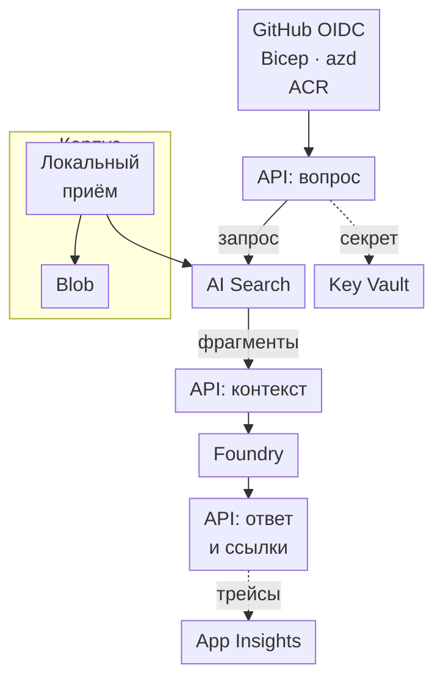

# Собери сервис ответов с проверяемыми ссылками на источники

В этом проекте ты соберёшь API на ASP.NET Core, которое отвечает на вопросы по трём документам из открытых источников и ссылается на исходные страницы. Ты сможешь проследить обработку запроса от поиска до генерации, развернуть сервис и повторить проверки. При написании кода приложения и файлов инфраструктуры ты используешь решения из упражнений курса.

Удалось скомпилировать вспомогательный C#-код, локальное API и программу приёма документов. Сквозной запуск в Azure не проводился. Облачные проверки ниже — критерии приёмки, которые предстоит выполнить.

## Цель и архитектура \{#goal-and-architecture}

Первую версию сделай с буферизацией ответа: `POST /ask` принимает `{"question":"Which role lets an application query Search?"}` и возвращает `answer` и массив `citations`, где каждая ссылка имеет поля `{id,title,url}`. Если документы не позволяют ответить, API возвращает HTTP 200, строку `I cannot answer from these documents.` и пустой массив ссылок. Если недоступна зависимость, нельзя подменять ошибку правдоподобным ответом. Документы пока загружаются вручную; действий через инструменты в проекте нет.



Все узлы с подписью API, включая сборку контекста, работают в одном Container App. Приём документов выполняется локально с учётными данными разработчика; отдельного облачного обработчика здесь нет. Снимки документов хранятся в закрытом Blob-контейнере учётной записи хранения (storage account), а ссылки в ответах ведут на открытые страницы Microsoft Learn.

Публичные конечные точки настрой по [сетевому упражнению](../part-1-azure-foundations/networking.md#try-it). [Ограничь входящие HTTP-запросы IP-адресом проверяющего](https://learn.microsoft.com/ru-ru/azure/container-apps/ip-restrictions). Управляемое удостоверение (managed identity) даёт API доступ к зависимостям Azure, но не проверяет, кто обращается к самому API. Прежде чем открыть доступ другим пользователям, реализуй в API аутентификацию отправителей HTTP-запросов.

| Компонент | Сервис или механизм .NET | Урок |
|---|---|---|
| HTTP-контракт и тесты | ASP.NET Core, тестовые двойники (test doubles) | [Тестирование](../part-2-modern-dotnet/testing.md#try-it) |
| Поиск и генерация | Azure AI Search, `Microsoft.Extensions.AI`, Foundry | [RAG на Azure AI Search](../part-3-llms-on-azure/rag-on-ai-search.md#try-it) |
| Снимки источников | Blob Storage, локальный приём документов | [Хранение данных](../part-1-azure-foundations/data.md#try-it) |
| Удостоверение работающего приложения и ссылка на секрет | Управляемое удостоверение, Key Vault | [Секреты и конфигурация](../part-1-azure-foundations/secrets-and-configuration.md#try-it) |
| Размещение и телеметрия | Container Apps, Application Insights | [Выбор вычислительной среды](../part-1-azure-foundations/compute.md#try-it), [Оценка качества и трассировка](../part-3-llms-on-azure/evaluation-and-tracing.md#try-it) |
| Создание инфраструктуры и поставка | Bicep, `azd`, GitHub Actions с OIDC | [Конвейеры поставки в Azure](../part-4-ai-delivery/pipelines-to-azure.md#try-it) |

## Этапы проекта \{#milestones}

### 1. Подготовь общую группу ресурсов и два развёртывания моделей \{#1-establish-one-resource-boundary-and-two-model-deployments}

Объедини упражнения [«Как устроен Azure»](../part-1-azure-foundations/how-azure-is-organised.md#try-it), [«RBAC и доступ без ключей»](../part-1-azure-foundations/rbac-and-keyless-access.md#try-it), [«Инфраструктура как код»](../part-1-azure-foundations/infrastructure-as-code.md#try-it), [«Microsoft Foundry»](../part-3-llms-on-azure/microsoft-foundry.md#try-it) и [«Развёртывания моделей, квоты и стоимость»](../part-3-llms-on-azure/deployments-quotas-cost.md#try-it).

Выдели приложению группу `rg-p1-rag-p1-ci`. Регион выбирай с учётом доступности моделей, квоты и политик подписки. Создай развёртывания моделей (model deployments) `p1-chat-lab` и `p1-embed-lab` и запиши версии самих моделей. В этом руководстве закреплены `gpt-5-mini` версии `2025-08-07` и `text-embedding-3-small` версии `1`. Обе модели ещё перечислены в документации, но перед созданием ресурсов проверь [таблицы доступности](https://learn.microsoft.com/ru-ru/azure/foundry/foundry-models/concepts/models-sold-directly-by-azure-region-availability) и [график вывода версий из эксплуатации](https://learn.microsoft.com/ru-ru/azure/foundry/openai/concepts/model-retirement-schedule).

Вместо точки входа на уровне группы ресурсов используй `infra/main.bicep` на уровне подписки. Этот файл создаёт группу с тегами, вызывает модуль ресурсов в её области действия и передаёт параметры мощности моделей:

```bicep
targetScope = 'subscription'
param environmentName string
param location string
param chatCapacity int
param embeddingCapacity int

resource appGroup 'Microsoft.Resources/resourceGroups@2022-09-01' = {
  name: 'rg-p1-rag-${environmentName}'
  location: location
  tags: {
    project: 'p1-rag'
    workload: 'p1-rag'
    environment: environmentName
    'azd-env-name': environmentName
    owner: 'learner'
  }
}
module resources './modules/p1-resources.bicep' = {
  name: 'p1-resources'
  scope: appGroup
  params: {
    location: location
    tags: appGroup.tags
    chatCapacity: chatCapacity
    embeddingCapacity: embeddingCapacity
  }
}
output AZURE_RESOURCE_GROUP string = appGroup.name
output P1_DELETION_INVENTORY string = string(resources.outputs.deletionInventory)
// Forward the remaining module outputs listed below unchanged.
```

Объявление группы соответствует [API resourceGroups](https://learn.microsoft.com/ru-ru/azure/templates/microsoft.resources/2022-09-01/resourcegroups). Исходный файл компилировался с [Bicep 0.48.1](https://github.com/Azure/bicep/releases/tag/v0.48.1), когда вызываемый модуль создавал только хранилище. Добавленный здесь выходной параметр и расширенные контракты модулей ещё не скомпилированы. Скомпилируй их отдельно до создания ресурсов; прежняя компиляция не подтверждает развёртывание этой инфраструктуры в Azure.

Реализуй контракты в таблице по связанным схемам ресурсов. Все модули работают на уровне группы, принимают `location` и общие `tags`, возвращают `id` и `name`. Для глобально уникальных имён используй общий суффикс `uniqueString(resourceGroup().id)`.

| Модуль и закреплённая схема ресурса | Входные параметры и связи | Дополнительные выходные параметры |
|---|---|---|
| `storage.bicep`: [Storage@2026-06-01](https://learn.microsoft.com/ru-ru/azure/templates/microsoft.storage/2026-06-01/storageaccounts) и [Blob container@2026-06-01](https://learn.microsoft.com/ru-ru/azure/templates/microsoft.storage/storageaccounts/blobservices/containers) | Перенеси существующее объявление Storage без изменений; добавь службу Blob `default`, дочерний контейнер `sources`, `publicAccess: 'None'`; задай учётной записи хранения `accessTier: 'Hot'` | `sourcesId` |
| `identity.bicep`: [userAssignedIdentities@2023-01-31](https://learn.microsoft.com/ru-ru/azure/templates/microsoft.managedidentity/2023-01-31/userassignedidentities) | Имя `id-p1-rag-api` | `clientId`, `principalId` |
| `models.bicep`: [accounts@2025-06-01](https://learn.microsoft.com/ru-ru/azure/templates/microsoft.cognitiveservices/2025-06-01/accounts), [projects](https://learn.microsoft.com/ru-ru/azure/templates/microsoft.cognitiveservices/2025-06-01/accounts/projects), [deployments](https://learn.microsoft.com/ru-ru/azure/templates/microsoft.cognitiveservices/2025-06-01/accounts/deployments) той же версии | Ресурс с `kind: 'AIServices'`, SKU `S0`, назначаемым системой удостоверением, уникальным `customSubDomainName`, `allowProjectManagement: true`, `disableLocalAuth: true`; дочерний проект `p1-rag` с назначаемым системой удостоверением; дочерние развёртывания с указанными выше версиями моделей, `format: 'OpenAI'`, SKU `GlobalStandard`; целочисленные `chatCapacity`, `embeddingCapacity` в пределах одобренной квоты | `endpoint` = `https://<customSubDomainName>.openai.azure.com/openai/v1/` |
| `search.bicep`: [searchServices@2025-05-01](https://learn.microsoft.com/ru-ru/azure/templates/microsoft.search/2025-05-01/searchservices) | Уникальное имя, SKU `free`, `disableLocalAuth: true`; несовместимый `authOptions` не указывай | `endpoint` |
| `vault.bicep`: [vaults@2024-11-01](https://learn.microsoft.com/ru-ru/azure/templates/microsoft.keyvault/2024-11-01/vaults) | Уникальное имя, тенант `tenant().tenantId`, семейство SKU `A`, имя SKU `standard`, `enableRbacAuthorization: true`, пустой `accessPolicies` | `vaultUri` |
| `registry.bicep`: [registries@2025-11-01](https://learn.microsoft.com/ru-ru/azure/templates/microsoft.containerregistry/2025-11-01/registries) | Уникальное буквенно-цифровое имя, SKU `Basic`, `adminUserEnabled: false`, `roleAssignmentMode: 'LegacyRegistryPermissions'` | `loginServer` |
| `telemetry.bicep`: [workspaces@2023-09-01](https://learn.microsoft.com/ru-ru/azure/templates/microsoft.operationalinsights/2023-09-01/workspaces) и [components@2020-02-02](https://learn.microsoft.com/ru-ru/azure/templates/microsoft.insights/2020-02-02/components) | Рабочая область Log Analytics (Log Analytics workspace) со SKU `PerGB2018`; Insights с `kind: 'web'`, `Application_Type: 'web'`, `WorkspaceResourceId: workspace.id` | `workspaceName`, `workspaceId`, `connectionString` |
| `host.bicep`: [managedEnvironments@2025-01-01](https://learn.microsoft.com/ru-ru/azure/templates/microsoft.app/2025-01-01/managedenvironments) | Принимает `workspaceName`; ссылается на существующую рабочую область и задаёт `appLogsConfiguration.destination: 'log-analytics'` и `logAnalyticsConfiguration: {customerId: workspace.properties.customerId, sharedKey: workspace.listKeys().primarySharedKey}`; имя и тип профиля рабочей нагрузки — `Consumption` | `id`, `name` среды |

Объяви оба параметра мощности в `p1-resources.bicep` и передай их в `models`. Имена символов модулей должны совпадать с именами файлов без расширения `.bicep`. Передача `telemetry.outputs.workspaceName` в `host` задаёт зависимость модулей:

```bicep
module telemetry './telemetry.bicep' = {
  name: 'telemetry'
  params: { location: location, tags: tags }
}
module host './host.bicep' = {
  name: 'host'
  params: {
    location: location
    tags: tags
    workspaceName: telemetry.outputs.workspaceName
  }
}
```

У проекта и развёртываний моделей укажи `parent: account`, а для Insights используй символьную ссылку на рабочую область. Если поставщик ресурсов отклоняет одновременные обновления, создавай развёртывания чата и эмбеддингов последовательно.

Уже при первом создании инфраструктуры верни все выходные параметры из таблицы настроек на этапе 5 и имя будущего приложения `ca-p1-rag-api`. Сразу добавь и объект `deletionInventory`: он понадобится для удаления ресурсов, даже если последующие этапы не завершатся.

```bicep
output deletionInventory object = {
  subscription: subscription().subscriptionId
  group: resourceGroup().name
  vault: { name: vault.outputs.name, id: vault.outputs.id, location: location }
  foundry: { name: models.outputs.name, id: models.outputs.id, location: location }
  workspace: { name: telemetry.outputs.workspaceName, id: telemetry.outputs.workspaceId }
}
```

После создания инфраструктуры назначь роли по таблице. Оператор здесь — разработчик, выполнивший вход; `identity.principalId` — идентификатор субъекта работающего приложения. В столбце области действия (`scope`) используй конкретные идентификаторы ресурсов, возвращённые модулями. Роли доступа к данным не назначай на всю группу приложения.

| Кому | Роль | Область действия |
|---|---|---|
| Работающему приложению | [Search Index Data Reader](https://learn.microsoft.com/ru-ru/azure/search/search-security-rbac) | Сервис Search |
| Работающему приложению и оператору, отдельными назначениями | [Foundry User](https://learn.microsoft.com/ru-ru/azure/foundry/concepts/rbac-foundry), `53ca6127-db72-4b80-b1b0-d745d6d5456d` | Ресурс Foundry |
| Работающему приложению | [Key Vault Secrets User](https://learn.microsoft.com/ru-ru/azure/key-vault/general/rbac-guide) | Хранилище Key Vault |
| Работающему приложению | AcrPull | Реестр |
| Оператору | [Storage Blob Data Contributor](https://learn.microsoft.com/ru-ru/azure/role-based-access-control/built-in-roles/storage) | Контейнер `sources` |
| Оператору | Search Service Contributor; Search Index Data Contributor, отдельными назначениями | Сервис Search |
| Оператору | Key Vault Secrets Officer | Хранилище Key Vault |

Для каждого назначения сразу сохраняй идентификатор, который возвращает [команда назначения роли](https://learn.microsoft.com/ru-ru/cli/azure/role/assignment?view=azure-cli-latest). Каталог `artifacts/` должен уже существовать:

```bash
az role assignment create --assignee-object-id '<principal-id>' \
  --assignee-principal-type '<User-or-ServicePrincipal>' \
  --role '<role-name-or-id>' --scope '<resource-id>' \
  --query id --output tsv >> artifacts/data-role-ids.txt
```

Не откладывай сохранение идентификаторов. Дождись распространения изменений RBAC и проверь доступ до приёма документов и развёртывания API. При обработке запросов приложение читает Search, поэтому роль для Blob ему не нужна. Оставь Shared Key и анонимный доступ отключёнными, а сервисы — с аутентификацией без ключей, как в упражнении [«AI для корпоративной среды»](../part-3-llms-on-azure/enterprise-ai.md#try-it).

В `infra/main.parameters.json` свяжи `environmentName` с `${AZURE_ENV_NAME}`, `location` — с `${AZURE_LOCATION}`, `chatCapacity` — с `${P1_CHAT_CAPACITY}`, `embeddingCapacity` — с `${P1_EMBED_CAPACITY}` по [соглашению о параметрах azd](https://learn.microsoft.com/ru-ru/azure/developer/azure-developer-cli/explore-edit-templates). Зарегистрируй сервис в `azure.yaml`; инфраструктуру пока создавай без развёртывания приложения:

```yaml
name: p1-rag
services:
  api:
    project: ./src/Rag.Api
    language: csharp
    host: containerapp
    module: api
```

Подставь подписку и выбранный регион вместо обоих значений-заполнителей. Введи одобренные значения мощности, скомпилируй Bicep и просмотри предварительный план до создания ресурсов. Команды используют [Bicep CLI](https://learn.microsoft.com/ru-ru/cli/azure/bicep?view=azure-cli-latest) и [azd](https://learn.microsoft.com/ru-ru/azure/developer/azure-developer-cli/reference):

```bash
az login
az account set --subscription '<subscription-id>'
azd auth login
azd env new p1-ci --subscription '<subscription-id>' --location '<chosen-region>'
read -r -p 'Quota-approved chat capacity: ' chat_capacity
read -r -p 'Quota-approved embedding capacity: ' embed_capacity
azd env set P1_CHAT_CAPACITY "$chat_capacity" --environment p1-ci
azd env set P1_EMBED_CAPACITY "$embed_capacity" --environment p1-ci
az bicep build --file infra/main.bicep --stdout
azd provision --environment p1-ci --preview
# Inspect the preview before running the next command.
mkdir -p artifacts
# Save a recovery boundary even if provisioning only partly succeeds.
az account show --query '{subscription:id}' --output json |
  jq '. + {group:"rg-p1-rag-p1-ci"}' > artifacts/p1-cleanup.json
azd provision --environment p1-ci
azd env get-value P1_DELETION_INVENTORY --environment p1-ci \
  > artifacts/p1-cleanup.json.tmp
jq -e . artifacts/p1-cleanup.json.tmp > /dev/null
mv artifacts/p1-cleanup.json.tmp artifacts/p1-cleanup.json
az resource list --resource-group rg-p1-rag-p1-ci --output json \
  > artifacts/p1-resources.json
```

Сохрани историю развёртывания: `azd env refresh` использует её для восстановления [значений окружения](https://learn.microsoft.com/ru-ru/azure/developer/azure-developer-cli/work-with-environments). Связь этих значений с настройками приложения задай явно по таблице на этапе 5.

**Проверка:** изучи список ресурсов, назначения ролей и сохранённые идентификаторы для удаления. По [правилам обнаружения ресурсов azd](https://learn.microsoft.com/ru-ru/azure/developer/azure-developer-cli/tooling-environment-faq#how-does-azd-find-the-azure-resource-to-deploy-my-code-to) команда `az group list --tag azd-env-name=p1-ci --query '[].name' --output tsv` должна найти группу упражнения. Если создание завершится лишь частично, используй сохранённые подписку и группу вместе со скриптом из раздела удаления ресурсов.

### 2. Подготовь локальное API к проверке HTTP-контракта \{#2-make-the-local-http-boundary-testable}

Собери упражнения [о платформе .NET](../part-2-modern-dotnet/dotnet-platform.md#try-it), [ASP.NET Core](../part-2-modern-dotnet/aspnet-core.md#try-it), [Microsoft.Extensions](../part-2-modern-dotnet/extensions-backbone.md#try-it) и [тестировании](../part-2-modern-dotnet/testing.md#try-it) в одном решении `RagService.slnx` с проектом `src/Rag.Api/Rag.Api.csproj`. Перенеси тестовую фикстуру (test fixture) в это решение, чтобы не сопровождать второе API.

Сохрани [.NET SDK `10.0.402` и среду выполнения `10.0.13`](https://dotnet.microsoft.com/en-us/download/dotnet/10.0), целевую платформу `net10.0`, отключённый переход на другие версии SDK и файлы фиксации зависимостей.

На запрос с пустым вопросом или вопросом длиннее 2 000 символов API должно возвращать HTTP 400 до вызова модели. Для корректного вопроса начальная заглушка возвращает 503. Оставь тесты с фиксированными документами и двойником модели, затем расширь их под окончательный контракт ответа. Вызовы всех зависимостей должны учитывать сигнал отмены и предельное время выполнения, как в уроке [«Асинхронность, потоки данных и отмена»](../part-2-modern-dotnet/async-streaming-cancellation.md#try-it). Базовая версия по-прежнему возвращает ответ целиком.

Запусти [восстановление зависимостей](https://learn.microsoft.com/ru-ru/dotnet/core/tools/dotnet-restore), [сборку](https://learn.microsoft.com/ru-ru/dotnet/core/tools/dotnet-build) и [тесты через VSTest](https://learn.microsoft.com/ru-ru/dotnet/core/tools/dotnet-test-vstest):

```bash
dotnet restore RagService.slnx --locked-mode
dotnet build RagService.slnx -c Release --no-restore
dotnet test RagService.slnx -c Release --no-build
```

**Проверка:** посмотри, какие тестовые случаи обнаружены и какие ответы получены. Ответ по фиксированному документу должен ссылаться на `doc-1`. Тестам не нужны учётные данные Azure.

### 3. Преврати снимки открытых страниц в доступные для поиска фрагменты \{#3-turn-public-snapshots-into-searchable-chunks}

Объедини упражнения [о хранении данных](../part-1-azure-foundations/data.md#try-it) и [RAG на Azure AI Search](../part-3-llms-on-azure/rag-on-ai-search.md#try-it). Сохрани в `corpus/` небольшие снимки трёх страниц Microsoft Learn: [таблицы ролей Search](https://learn.microsoft.com/ru-ru/azure/search/search-security-rbac), [настройки ролей Search](https://learn.microsoft.com/ru-ru/azure/search/search-security-enable-roles) и [управляемых удостоверений Container Apps](https://learn.microsoft.com/ru-ru/azure/container-apps/managed-identity).

Раздели снимки по заголовкам на короткие фрагменты (chunk) со стабильными идентификаторами `doc-N`. Для каждого фрагмента запиши `{id,file,title,url,retrievedAt,heading}` в массив `corpus/manifest.json`. Сохраняй название и открытый адрес источника `sourceUrl`. Загрузи Markdown-снимки в `sources` с [аутентификацией Microsoft Entra](https://learn.microsoft.com/ru-ru/azure/storage/blobs/authorize-data-operations-cli):

```bash
read -r -p 'Storage account from the inventory: ' storage
az storage blob upload-batch --account-name "$storage" --destination sources \
  --source corpus --pattern '*.md' --auth-mode login
```

Создай консольный проект `tools/Rag.Ingest/Rag.Ingest.csproj` с клиентом эмбеддингов (embeddings) и [клиентом загрузки документов Search](https://learn.microsoft.com/ru-ru/dotnet/api/azure.search.documents.searchclient.uploaddocumentsasync?view=azure-dotnet). Поддержи параметры `--manifest`, `--index` и `--out`: программа читает локальные фрагменты, создаёт или обновляет индекс, вычисляет эмбеддинги, загружает документы и записывает результат `{id,succeeded,errorMessage}` для каждого из них. При любой ошибке она должна завершаться с ненулевым кодом. Для доступа используй роли оператора из этапа 1. Основы поиска разобраны в уроке [Retrieval](/rag-agents/part-1-rag/retrieval/).

В поисковом индексе (search index) `public-docs` замени искусственные трёхмерные векторы настоящими эмбеддингами: размерность `contentVector` должна быть `1536`. Проверяй длину каждого эмбеддинга. Для запросов нужны те же модель, версия и размерность, что и для документов; это часть [контракта индекса](https://learn.microsoft.com/ru-ru/azure/search/vector-search-how-to-create-index). Сохрани схему в `infra/search-index.json`, а результат приёма документов — в `artifacts/ingestion.json`.

Загрузи настройки `AI` и `Rag` из таблицы этапа 5 и выполни:

```bash
dotnet run --project tools/Rag.Ingest -- \
  --manifest corpus/manifest.json --index infra/search-index.json \
  --out artifacts/ingestion.json
jq -e 'length > 0 and all(.[]; .succeeded == true)' artifacts/ingestion.json
```

**Проверка:** получи по известному идентификатору из манифеста документ и его текст. Гибридный запрос (hybrid query) должен возвращать выбранные поля источника, но определённый порядок результатов и конкретные значения оценок здесь не гарантируются.

### 4. Соедини поиск с генерацией и проверь ссылки на источники \{#4-join-retrieval-to-generation-and-validate-citations}

Объедини упражнения [«AI в .NET»](../part-2-modern-dotnet/ai-in-dotnet.md#try-it), [«RAG на Azure AI Search»](../part-3-llms-on-azure/rag-on-ai-search.md#try-it), [«Защита на уровне платформы»](../part-3-llms-on-azure/platform-safety.md#try-it) и задание о ссылках из урока [«Агенты для программирования в .NET-проекте»](../part-4-ai-delivery/coding-agents-dotnet.md#try-it).

Сохрани версии пакетов [Azure.Identity `1.21.0`](https://www.nuget.org/packages/Azure.Identity/1.21.0), [OpenAI `2.14.0`](https://www.nuget.org/packages/OpenAI/2.14.0), [Microsoft.Extensions.AI `10.11.0`](https://www.nuget.org/packages/Microsoft.Extensions.AI/10.11.0), [Microsoft.Extensions.AI.OpenAI `10.11.0`](https://www.nuget.org/packages/Microsoft.Extensions.AI.OpenAI/10.11.0) и [Azure.Search.Documents `12.0.0`](https://www.nuget.org/packages/Azure.Search.Documents/12.0.0). Подавление `OPENAI001` оставь только там, где в упражнении создаётся клиент с bearer-токеном.

Добавь этот код в `src/Rag.Api/P1Retrieval.cs`. Он соединяет [`GenerateVectorAsync`](https://learn.microsoft.com/ru-ru/dotnet/api/microsoft.extensions.ai.embeddinggeneratorextensions.generatevectorasync?view=net-10.0-pp) с [`VectorizedQuery`](https://learn.microsoft.com/ru-ru/dotnet/api/azure.search.documents.models.vectorizedquery?view=azure-dotnet):

```csharp
using Azure.Search.Documents;
using Azure.Search.Documents.Models;
using Microsoft.Extensions.AI;

public static class P1Retrieval
{
    public static async Task<List<SearchDocument>> FindAsync(
        SearchClient search,
        IEmbeddingGenerator<string, Embedding<float>> embeddings,
        string question,
        CancellationToken cancellationToken)
    {
        var vector = await embeddings.GenerateVectorAsync(
            question, cancellationToken: cancellationToken);
        if (vector.Length != 1536)
            throw new InvalidOperationException("Embedding dimensions changed.");

        var options = new SearchOptions
        {
            Size = 3,
            Select = { "id", "title", "content", "sourceUrl" },
            SearchFields = { "title", "content" },
            VectorSearch = new VectorSearchOptions
            {
                Queries =
                {
                    new VectorizedQuery(vector)
                    {
                        KNearestNeighborsCount = 5,
                        Fields = { "contentVector" }
                    }
                }
            }
        };
        var response = await search.SearchAsync<SearchDocument>(
            question, options, cancellationToken);
        var documents = new List<SearchDocument>();
        await foreach (var result in response.Value.GetResultsAsync()
            .WithCancellation(cancellationToken))
            documents.Add(result.Document);
        return documents;
    }
}
```

Текст вопроса ищется по `title` и `content`, а его вектор — по `contentVector`. Значение `k=5` задаёт число соседей для векторного поиска; `Size=3` ограничивает число возвращаемых результатов. Это параметры упражнения. Сигнал отмены передаётся при вычислении эмбеддинга, запросе Search и чтении результатов.

Этот вспомогательный код без изменений собирался в минимальном проекте и в локальных проектах API и приёма документов с .NET SDK `10.0.402`, .NET и ASP.NET Core `10.0.13`, Azure.Identity `1.21.0`, OpenAI `2.14.0`, Microsoft.Extensions.AI и Microsoft.Extensions.AI.OpenAI `10.11.0`, Azure.Search.Documents `12.0.0`, Microsoft.OpenTelemetry `1.2.0`; проверено 19.10.2026. Локально удалось восстановить зависимости с `--locked-mode`, выполнить сборку Release и пройти 13 тестов. API запускалось. Приём документов и `/ask` с настоящими адаптерами завершались ошибкой получения учётных данных. Повтор запросов и запись пяти строк для оценки проверялись с локальными тестовыми двойниками. Для этих локальных проверок использовалась временная реализация проекта. В действующей подписке Azure не выполнялись вызовы сервисов, развёртывание, экспорт или оценка.

Помечай переданные модели фрагменты как `[doc-N]` и требуй отвечать только по контексту. После генерации сверь маркеры с идентификаторами найденных фрагментов. Значения `{id,title,url}` составляй из тех же [выбранных полей Search](https://learn.microsoft.com/ru-ru/azure/search/search-query-create): значение `sourceUrl` записывай в поле `url`. В учебный индекс пишет только оператор приёма документов; он же проверяет адреса из манифеста при загрузке. Работающему API не нужен доступ ни к манифесту, ни к Blob.

Если нет допустимой ссылки, поиск ничего не вернул или данных для ответа не хватает, возвращай фиксированный отказ. Если модель выдумала идентификатор ссылки, возвращай HTTP 502 без тела. Блокировка средствами безопасности, ошибка при выполнении проверки безопасности и сбой зависимости должны сохранять разные контракты ошибок из урока о защите платформы; детали исключений наружу не передавай. Проверка маркеров и метаданных не доказывает правильность каждого утверждения со ссылкой — ограничения разобраны в уроке [Generation](/rag-agents/part-1-rag/generation/).

Сохрани положительные тесты, отрицательные и тесты со смесью допустимых и недопустимых ссылок. Подготовь пять случаев в `fixtures/ask.jsonl`, выбрав ожидаемые идентификаторы из своих снимков. Один случай проверяет вопрос вне корпуса:

```json
{"name":"outside-corpus","question":"What is the weather tomorrow?","refusal":true,"allowedIds":[]}
```

Для него `POST /ask` с `Content-Type: application/json` и телом `{"question":"What is the weather tomorrow?"}` должен вернуть HTTP 200 и `{"answer":"I cannot answer from these documents.","citations":[]}`. Для вопроса, на который документы позволяют ответить, задай `refusal:false` и соответствующие `allowedIds:["doc-1"]`.

Сохрани скрипт с [curl](https://curl.se/docs/manpage.html) в `scripts/replay.sh`. Он последовательно отправляет вопросы из файла фикстур, проверяет статус, формат ответа и метаданные ссылок. Формулировка сгенерированного ответа не фиксируется:

```bash
#!/usr/bin/env bash
set -euo pipefail
base=${1:?Pass the API base URL}
mkdir -p artifacts/replay
while IFS= read -r case; do
  name=$(jq -r .name <<< "$case")
  output="artifacts/replay/$name.json"
  code=$(jq '{question}' <<< "$case" | curl -sS -o "$output" -w '%{http_code}' \
    -H "X-Eval-Case-Id: $name" \
    -H 'Content-Type: application/json' --data-binary @- "$base/ask")
  test "$code" = 200
  jq -e --argjson c "$case" --slurpfile m corpus/manifest.json '
    (.answer | type == "string") and (.citations | type == "array") and
    (if $c.refusal then
       .answer == "I cannot answer from these documents." and .citations == []
     else (.answer | length > 0) and (.citations | length > 0) and
       all(.citations[]; . as $x |
         ($c.allowedIds | index($x.id)) != null and
         any($m[0][]; .id == $x.id and .title == $x.title and .url == $x.url))
     end)' "$output"
done < fixtures/ask.jsonl
```

**Проверка:** загрузи настройки Azure и запусти API через [`dotnet run`](https://learn.microsoft.com/ru-ru/dotnet/core/tools/dotnet-run): `dotnet run --project src/Rag.Api --no-launch-profile --urls http://localhost:5080`. В другом терминале выполни `bash scripts/replay.sh http://localhost:5080`. Манифест остаётся у оператора, который запускает проверку.

### 5. Разверни API с удостоверением, настройками и трейсами \{#5-deploy-the-api-with-identity-settings-and-traces}

Объедини упражнения [о вычислениях](../part-1-azure-foundations/compute.md#try-it), [секретах и конфигурации](../part-1-azure-foundations/secrets-and-configuration.md#try-it), [контейнерах и Aspire](../part-2-modern-dotnet/containers-and-aspire.md#try-it) и [наблюдаемости](../part-1-azure-foundations/observability.md#try-it). HTTP-контракт сохрани.

В `infra/main.bicep` оставь только общую инфраструктуру. Приложение объяви в `infra/api.bicep`, который вызывается при развёртывании сервиса по [стратегии azd с ревизиями](https://learn.microsoft.com/ru-ru/azure/developer/azure-developer-cli/container-apps-workflows#revision-based-deployment-strategy). Первый `azd deploy` собирает и отправляет настоящий образ API и передаёт `SERVICE_API_IMAGE_NAME`; образ-заполнитель не нужен. Повторное создание общей инфраструктуры не меняет образ приложения.

Используй [API Container App `2025-01-01`](https://learn.microsoft.com/ru-ru/azure/templates/microsoft.app/2025-01-01/containerapps). Модуль сервиса должен задавать образ, настройки, проверки работоспособности и готовности, профиль `Consumption`, число реплик от 0 до 1 и начальные ресурсы 0,25 vCPU и 0,5 GiB. Укажи `8080` как целевой порт API в настройках входящего трафика Container App; маршруты проверок должны совпадать с маршрутами API. Добавь разрешающее правило `Allow` для `testerCidr`.

Подключи к приложению удостоверение `id-p1-rag-api`. Для загрузки образа из реестра используй идентификатор ресурса этого удостоверения и роль [`AcrPull`](https://learn.microsoft.com/ru-ru/azure/container-apps/managed-identity-image-pull). Для [обнаружения сервиса azd](https://learn.microsoft.com/ru-ru/azure/developer/azure-developer-cli/container-apps-workflows) нужен тег `azd-service-name=api`.

Локально оставь `DefaultAzureCredential`, а в Azure явно выбирай [`ManagedIdentityCredential`](https://learn.microsoft.com/ru-ru/dotnet/azure/sdk/authentication/user-assigned-managed-identity) по идентификатору клиента. Роль `Key Vault Secrets User` назначается идентификатору субъекта работающего приложения. Оператор с ролью `Key Vault Secrets Officer` должен записать искусственный секрет `p1-integration-marker`. Через [механизм секретов Container Apps](https://learn.microsoft.com/ru-ru/azure/container-apps/manage-secrets) настрой ссылку `keyVaultUrl` с идентификатором ресурса удостоверения, а для переменной окружения — `secretRef`. Приложение проверяет наличие значения, не возвращая его. Этот маркер нужен для упражнения со ссылкой на Key Vault; ключи API сервисов Azure здесь не используются.

Передай через общую инфраструктуру все выходные параметры таблицы. Те же явные соответствия используй локально и при развёртывании. В параметрах `AI` оставь проверку конфигурации, а дублирующее свойство `Rag:DeploymentName` и его проверку из упражнения о Microsoft.Extensions убери.

| Выходной параметр Bicep | Настройка приложения или назначение |
|---|---|
| `AI_ENDPOINT` | `AI__Endpoint`, настоящий адрес с `/openai/v1/` |
| `AI_CHAT_DEPLOYMENT`, `AI_EMBEDDING_DEPLOYMENT` | `AI__ChatDeployment`, `AI__EmbeddingDeployment` |
| `SEARCH_ENDPOINT`, `SEARCH_INDEX_NAME` | `Rag__SearchEndpoint`, `Rag__IndexName=public-docs` |
| `API_IDENTITY_CLIENT_ID` | Выбор учётных данных работающего приложения |
| `APPLICATIONINSIGHTS_CONNECTION_STRING` | Одноимённая настройка экспортёра |
| `AZURE_CONTAINER_REGISTRY_ENDPOINT`, `AZURE_CONTAINER_REGISTRY_NAME` | Сборка и отправка образа через `azd` |
| `AZURE_RESOURCE_GROUP`, `AZURE_CONTAINER_APP_NAME` | Обнаружение ресурсов и проверки |
| `STORAGE_ACCOUNT_NAME`, `KEY_VAULT_NAME`, `FOUNDRY_NAME`, `LOG_WORKSPACE_NAME` | Приём документов и перечень ресурсов для удаления |
| `AZURE_CONTAINER_ENVIRONMENT_NAME`, `SERVICE_API_IDENTITY_ID` | Ссылки на ресурсы при развёртывании |
| `P1_DELETION_INVENTORY` | JSON с именами, идентификаторами и расположением ресурсов; сохраняется при первом создании инфраструктуры |

В `infra/api.parameters.json` задай следующие подстановки:

```json
{
  "$schema": "https://schema.management.azure.com/schemas/2019-04-01/deploymentParameters.json#",
  "contentVersion": "1.0.0.0",
  "parameters": {
    "environmentName": {"value":"${AZURE_ENV_NAME}"},
    "location": {"value":"${AZURE_LOCATION}"},
    "containerRegistryName": {"value":"${AZURE_CONTAINER_REGISTRY_NAME}"},
    "containerAppsEnvironmentName": {"value":"${AZURE_CONTAINER_ENVIRONMENT_NAME}"},
    "identityId": {"value":"${SERVICE_API_IDENTITY_ID}"},
    "imageName": {"value":"${SERVICE_API_IMAGE_NAME}"},
    "testerCidr": {"value":"${P1_TESTER_CIDR}"},
    "aiEndpoint": {"value":"${AI_ENDPOINT}"},
    "chatDeployment": {"value":"${AI_CHAT_DEPLOYMENT}"},
    "embeddingDeployment": {"value":"${AI_EMBEDDING_DEPLOYMENT}"},
    "searchEndpoint": {"value":"${SEARCH_ENDPOINT}"},
    "indexName": {"value":"${SEARCH_INDEX_NAME}"},
    "clientId": {"value":"${API_IDENTITY_CLIENT_ID}"},
    "insightsConnectionString": {"value":"${APPLICATIONINSIGHTS_CONNECTION_STRING}"},
    "vaultName": {"value":"${KEY_VAULT_NAME}"}
  }
}
```

В `api.bicep` объяви соответствующие строковые параметры и ссылки на существующие ресурсы. Задай `containers[0].image: imageName`, `configuration.activeRevisionsMode: 'Single'` и распределение запросов `[{latestRevision:true,weight:100}]`. В `env` перенеси настройки из таблицы. Значение `API_IDENTITY_CLIENT_ID` свяжи с настройкой учётных данных, которую читает приложение. Для `configuration.registries` укажи сервер входа в реестр и `identityId`; тот же идентификатор используй ключом в `identity.userAssignedIdentities`. К общим тегам добавь `'azd-service-name': 'api'`. В граф модулей `main.bicep` файл `api.bicep` не включай.

Задай `P1_TESTER_CIDR` для разрешённого IP-адреса: `azd env set P1_TESTER_CIDR '<your-public-ip>/32' --environment p1-ci`.

До упаковки приложения подключи инструментирование (instrumentation) из урока [«Оценка качества и трассировка»](../part-3-llms-on-azure/evaluation-and-tracing.md#try-it) с пакетом [Microsoft.OpenTelemetry `1.2.0`](https://www.nuget.org/packages/Microsoft.OpenTelemetry/1.2.0). Инструментируй вызовы модели только через `P1.ModelCalls`, отключи сбор чувствительных данных и исключи дублирующий экспорт из Aspire. Ресурсы телеметрии должны находиться в группе приложения.

Разверни приложение командой `azd deploy --environment p1-ci`. Повторяй создание общей инфраструктуры только после изменения её описания.

**Проверка:** убедись, что ревизия (revision) и её проверки работоспособности и готовности в порядке. Команда `az resource list -g rg-p1-rag-p1-ci --tag azd-service-name=api --query '[].name' -o tsv` должна найти `ca-p1-rag-api`. С разрешённого IP-адреса выполни `bash scripts/replay.sh https://<app-fqdn>`. Сравнение с локальным манифестом проверяет метаданные ссылок развёрнутого API; помещать манифест в контейнер не нужно. В Application Insights найди трейс (trace) с вызовами Search и модели. Убедись, что в обычную телеметрию не попали исходные вопросы и фрагменты. После создания инфраструктуры обновляй перечень ресурсов.

### 6. Запиши пять ответов и разбери результаты оценки \{#6-capture-five-answers-and-inspect-their-evaluation}

Используй упражнение [«Оценка качества и трассировка»](../part-3-llms-on-azure/evaluation-and-tracing.md#try-it); принципы оценки разобраны в уроке [«Измерять качество, а не гадать»](/rag-agents/part-1-rag/cross-cutting/evaluation/). Запусти то же API локально в режиме `Development` с `P1_CAPTURE_EVAL=1`. Начни с пустого файла и выполни `bash scripts/replay.sh http://localhost:5080`: скрипт отправит пять вопросов последовательно, передавая имя случая в заголовке `X-Eval-Case-Id`, который нужен блоку записи данных из связанного упражнения.

В `p1-eval.jsonl` записывай итоговый вопрос `question` как `query`, возвращённый ответ как `response`, а точные фрагменты, переданные модели, — как `context`. Рядом сохраняй идентификатор случая, идентификатор трейса и версии выпуска, промпта, индекса и развёртывания модели.

Используй существующий проект Foundry и развёртывание модели-судьи, к которому разрешён доступ, для оценки Groundedness и Relevance по [инструкции для портала](https://learn.microsoft.com/ru-ru/azure/foundry/how-to/evaluate-generative-ai-app). В конфигурации Azure запись этих данных должна оставаться отключённой. [Токены модели-судьи увеличивают расход](https://azure.microsoft.com/en-us/pricing/details/foundryobservability/).

**Проверка:** в файле должно быть пять строк правильного формата. Прочитай каждый ответ, затем сравни отдельные баллы и ошибки оценки. Успешный прогон пяти случаев и завершение задания оценки подтверждают работу интеграции, но не качество сервиса в проде.

### 7. Настрой поставку через OIDC и отработай откат \{#7-deliver-through-oidc-and-rehearse-rollback}

Возьми рабочий процесс с действиями, закреплёнными по SHA, из упражнения [«Конвейеры поставки в Azure»](../part-4-ai-delivery/pipelines-to-azure.md#try-it), обнови пути к решению и используй упражнение [«Безопасный выпуск изменений»](../part-4-ai-delivery/releasing-safely.md#try-it). Администратор заранее создаёт инфраструктуру и назначения RBAC; конвейер выполняет `azd deploy`, а не создание инфраструктуры.

Создай отдельное удостоверение `p1-delivery` в группе `rg-p1-delivery-lab`. Назначь ему `Contributor` на группу приложения, `AcrPush` на реестр и `Reader` на подписку для обнаружения ресурсов. Каждый идентификатор назначения роли сразу записывай в `artifacts/delivery-role-ids.txt`.

Перед созданием федеративной связи проверь фактические значения издателя, субъекта токена и аудитории GitHub. Отдельно настрой переменные и правило одобрения в окружении GitHub `p1-ci`, а также окружение приложения `azd`. При развёртывании этот рабочий процесс заново упаковывает исходный код, а не использует тот же образ, который прошёл тесты.

**Проверка:** рабочий процесс для PR выполняет тесты без развёртывания. Запуск из `main`, который соответствует условиям развёртывания в этом рабочем процессе, должен ждать настроенного одобрения. После развёртывания повтори запросы из фикстур и проверь трейсы. Для упражнения с канареечным релизом (canary release) временно переключись с обычного режима `Single` на `Multiple`, создай и проверь кандидата на выпуск, затем ненадолго задай доли запросов (traffic weights) `90/10` для конкретных ревизий. Выполни откат (rollback) на прежнюю проверенную ревизию и деактивируй кандидата.

Пока действует это распределение, не запускай `azd deploy`: шаблон сервиса вернёт `Single` и 100% запросов последней ревизии. До следующего развёртывания восстанови прежний проверенный образ и базовую конфигурацию. Повторное создание общей инфраструктуры ревизии приложения не меняет.

## Стоимость \{#cost}

До создания ресурсов сверься с [учебным бюджетом курса](../intro.md#budget) и тарифами своего региона. После упражнения удали ресурсы: при нуле реплик API реестр и другие ресурсы остаются. Предложения для бесплатной учётной записи зависят от срока и соответствия условиям; они отличаются от регулярно возобновляемых бесплатных объёмов отдельных сервисов. Измеренной общей стоимости проекта или гарантированной месячной цены здесь нет.

| Ресурс и тариф | Единица тарификации | Применимый бесплатный объём | От чего зависит счёт; действующие цены |
|---|---|---|---|
| Container Apps Consumption | vCPU-секунды, GiB-секунды, запросы | На подписку в месяц: 180 000 vCPU-s, 360 000 GiB-s, 2 млн запросов | Время работы реплик, память и трафик; [цены](https://azure.microsoft.com/en-us/pricing/details/container-apps/) |
| Azure AI Search Free | Совместно используемый сервис | Один на подписку; 50 MB, три индекса; без семантического ранжировщика | Сервис бесплатный; на платных тарифах оплачивается мощность; [тарифы](https://learn.microsoft.com/ru-ru/azure/search/search-sku-tier), [цены](https://azure.microsoft.com/en-us/pricing/details/search/) |
| Модели Foundry Global Standard | Входные и выходные токены; входные токены эмбеддингов | Постоянный бесплатный объём токенов не предполагается | Приём документов, запросы, ответы и вызовы модели-судьи; [цены моделей](https://azure.microsoft.com/en-us/pricing/details/ai-foundry-models/aoai/) |
| Blob Hot, Standard LRS | GB-месяц, операции, передача данных | Предложение на 12 месяцев для новых учётных записей, соответствующих условиям: 5 GB, 20 000 чтений и 10 000 записей в месяц | Снимки, операции и передача данных; [цены](https://azure.microsoft.com/en-us/pricing/details/storage/blobs/), [таблица предложений](https://azure.microsoft.com/en-au/pricing/free-services) |
| Key Vault Standard | Операции с секретами, по 10 000 | Предложение на 12 месяцев для новых учётных записей, соответствующих условиям: 10 000 операций с секретами Standard или ключами RSA-2048 в месяц | Получение и обновление секретов; [цены](https://azure.microsoft.com/en-us/pricing/details/key-vault/), [таблица предложений](https://azure.microsoft.com/en-au/pricing/free-services) |
| ACR Basic | Реестр-день; дополнительное хранение, сборка и передача данных | Включено 10 GB; применимого постоянного бесплатного объёма нет. Предложение Standard на 12 месяцев для соответствующих условиям клиентов относится к другому тарифу | Реестр остаётся при нуле реплик API; [цены](https://azure.microsoft.com/en-us/pricing/details/container-registry/), [предложение для учётной записи](https://azure.microsoft.com/en-us/pricing/purchase-options/azure-account) |
| Application Insights и Log Analytics, Analytics PAYG | Объём принятых данных (GB), объём и срок хранения (GB-месяцы) | Первые 5 GB в месяц на учётную запись для выставления счетов; для данных Application Insights включено хранение в течение 90 дней | Объём трейсов, срок хранения и другие данные рабочей области; [цены Monitor](https://azure.microsoft.com/en-us/pricing/details/monitor/) |
| Управляемые удостоверения, ARM | Удостоверения и плоскость управления | Дополнительной платы за удостоверение нет; ARM всегда бесплатный | Подключённые сервисы оплачиваются по собственным единицам тарификации; [удостоверения](https://learn.microsoft.com/ru-ru/entra/identity/managed-identities-azure-resources/overview), [таблица для учётной записи](https://azure.microsoft.com/en-us/pricing/purchase-options/azure-account) |

## Удаление ресурсов \{#teardown}

Отключи рабочие процессы и останови приём документов, запросы и оценку. Скрипт должен запускать тот же администратор, который изначально создавал инфраструктуру. Для запуска нужен Bash с `az` и `jq`. Скрипт использует `artifacts/p1-cleanup.json`, сохранённый при первом создании ресурсов, и обновляет перечень, пока группа существует, в том числе после частично завершившегося создания. Перед удалением просмотри сохранённые имена.

Сначала выполняется [окончательное удаление рабочей области](https://learn.microsoft.com/ru-ru/azure/azure-monitor/logs/delete-workspace), затем — удаление групп. Для окончательного удаления ресурсов [Foundry](https://learn.microsoft.com/ru-ru/azure/ai-services/recover-purge-resources?tabs=azure-cli) и [Key Vault](https://learn.microsoft.com/ru-ru/azure/key-vault/general/soft-delete-overview) используются сохранённые идентификаторы и расположения. Если окончательное удаление не проходит, получи нужные права или дождись окончания защиты от окончательного удаления и повтори скрипт. Уже обратимо удалённую рабочую область сначала нужно восстановить, чтобы удалить окончательно.

Скрипт не зависит от выходных параметров этапа 5 или вызовов `show` к существующим ресурсам. При повторном запуске отсутствующие группы пропускаются. Существующий бюджет подписки остаётся без изменений.

```bash
#!/usr/bin/env bash
set -euo pipefail
inventory=artifacts/p1-cleanup.json
subscription=$(jq -er .subscription "$inventory")
group=$(jq -er .group "$inventory")
delivery_group=rg-p1-delivery-lab
az account set --subscription "$subscription"
test "$group" = rg-p1-rag-p1-ci

if [[ $(az group exists --name "$group") == true ]]; then
  az resource list --resource-group "$group" --output json > artifacts/p1-live.json
  jq --slurpfile live artifacts/p1-live.json '
    def item($t): first($live[0][] | select((.type|ascii_downcase) == $t) |
      {name,id,location}) // null;
    .vault = (item("microsoft.keyvault/vaults") // .vault) |
    .foundry = (item("microsoft.cognitiveservices/accounts") // .foundry) |
    .workspace = (item("microsoft.operationalinsights/workspaces") // .workspace)
  ' "$inventory" > "$inventory.tmp"
  mv "$inventory.tmp" "$inventory"
  cat "$inventory"
  workspace=$(jq -r 'first(.[] | select((.type|ascii_downcase) ==
    "microsoft.operationalinsights/workspaces") | .name) // empty' artifacts/p1-live.json)
  if [[ -n "$workspace" ]]; then
    az monitor log-analytics workspace delete --resource-group "$group" \
      --workspace-name "$workspace" --force true --yes
  fi
fi

# Saved grant IDs survive deletion of the delivery identity/group.
if [[ -f artifacts/delivery-role-ids.txt ]]; then
  az role assignment list --all --output json > artifacts/current-roles.json
  while IFS= read -r assignment; do
    [[ -n "$assignment" ]] || continue
    if jq -e --arg id "$assignment" 'any(.[]; .id == $id)' \
      artifacts/current-roles.json > /dev/null; then
      az role assignment delete --ids "$assignment"
    fi
  done < artifacts/delivery-role-ids.txt
fi
if [[ $(az group exists --name "$delivery_group") == true ]]; then
  az group delete --name "$delivery_group" --yes
fi
if [[ $(az group exists --name "$group") == true ]]; then
  az group delete --name "$group" --yes
fi

vault_id=$(jq -r '.vault.id // empty' "$inventory")
foundry_id=$(jq -r '.foundry.id // empty' "$inventory")
az keyvault list-deleted --output json > artifacts/deleted-vaults.json
az cognitiveservices account list-deleted --output json > artifacts/deleted-foundry.json
if [[ -n "$vault_id" ]] && jq -e --arg id "$vault_id" \
  'any(.[]; (.properties.vaultId|ascii_downcase) == ($id|ascii_downcase))' \
  artifacts/deleted-vaults.json > /dev/null; then
  az keyvault purge --name "$(jq -r .vault.name "$inventory")" \
    --location "$(jq -r .vault.location "$inventory")"
fi
if [[ -n "$foundry_id" ]] && jq -e --arg id "$foundry_id" \
  'any(.[]; (.id|ascii_downcase) == ($id|ascii_downcase))' \
  artifacts/deleted-foundry.json > /dev/null; then
  az cognitiveservices account purge --name "$(jq -r .foundry.name "$inventory")" \
    --resource-group "$group" --location "$(jq -r .foundry.location "$inventory")"
fi
# Refresh after purge; a failure here means cleanup is still incomplete.
az keyvault list-deleted --output json > artifacts/deleted-vaults-after.json
az cognitiveservices account list-deleted --output json > artifacts/deleted-foundry-after.json
jq -e --arg id "$vault_id" \
  'all(.[]; (.properties.vaultId|ascii_downcase) != ($id|ascii_downcase))' \
  artifacts/deleted-vaults-after.json
jq -e --arg id "$foundry_id" \
  'all(.[]; (.id|ascii_downcase) != ($id|ascii_downcase))' \
  artifacts/deleted-foundry-after.json
test "$(az group exists --name "$group")" = false
test "$(az group exists --name "$delivery_group")" = false
if [[ -f artifacts/delivery-role-ids.txt ]]; then
  az role assignment list --all --output json > artifacts/remaining-roles.json
  while IFS= read -r assignment; do
    [[ -z "$assignment" ]] || jq -e --arg id "$assignment" \
      'all(.[]; .id != $id)' artifacts/remaining-roles.json
  done < artifacts/delivery-role-ids.txt
fi
echo 'Owned groups, saved delivery grants and owned soft deletes are absent.'
```

Затем удали конфигурацию окружения GitHub. Исходный код, фикстуры и перечень ресурсов сохрани как учебные материалы. Когда поступят записи об использовании, проверь Cost Management: отсутствие групп подтверждает удаление ресурсов, но окончательная сумма счёта появляется не сразу.

## Что ты сможешь объяснить после проекта \{#what-you-can-explain-afterwards}

- Зачем нужны разные удостоверения и роли для работающего приложения, приёма документов и конвейера поставки?
- Как версия модели и размерность эмбеддингов ограничивают обновление индекса?
- Из чего состоит гибридный поиск и чем `k` отличается от числа возвращаемых результатов?
- Как отклоняются выдуманные ссылки и почему это не доказывает правильность каждого утверждения со ссылкой?
- Чем различаются отказ отвечать, ошибка зависимости и пустой ответ при ошибке ссылки?
- Что по отдельности подтверждают оценка пяти ответов и успешное развёртывание?
- За что можно платить при нуле реплик и какие ресурсы после удаления ещё можно восстановить?

## Источники \{#sources}

Проверено на 19.10.2026.

- [.NET 10 downloads](https://dotnet.microsoft.com/en-us/download/dotnet/10.0)
- [Resource-group Bicep API](https://learn.microsoft.com/ru-ru/azure/templates/microsoft.resources/2022-09-01/resourcegroups) и [Bicep CLI](https://learn.microsoft.com/ru-ru/cli/azure/bicep?view=azure-cli-latest)
- [Foundry resource configuration](https://learn.microsoft.com/ru-ru/azure/foundry/how-to/upgrade-azure-openai) и [OpenAI v1 endpoint formats](https://learn.microsoft.com/ru-ru/azure/foundry/openai/api-version-lifecycle)
- [Foundry RBAC](https://learn.microsoft.com/ru-ru/azure/foundry/concepts/rbac-foundry)
- [Model availability](https://learn.microsoft.com/ru-ru/azure/foundry/foundry-models/concepts/models-sold-directly-by-azure-region-availability) и [retirement schedule](https://learn.microsoft.com/ru-ru/azure/foundry/openai/concepts/model-retirement-schedule)
- [Search RBAC](https://learn.microsoft.com/ru-ru/azure/search/search-security-rbac), [role configuration](https://learn.microsoft.com/ru-ru/azure/search/search-security-enable-roles), [vector indexes](https://learn.microsoft.com/ru-ru/azure/search/vector-search-how-to-create-index) и [hybrid queries](https://learn.microsoft.com/ru-ru/azure/search/hybrid-search-how-to-query)
- [azd Container Apps deployment strategies](https://learn.microsoft.com/ru-ru/azure/developer/azure-developer-cli/container-apps-workflows), [resource discovery](https://learn.microsoft.com/ru-ru/azure/developer/azure-developer-cli/tooling-environment-faq#how-does-azd-find-the-azure-resource-to-deploy-my-code-to) и [traffic splitting](https://learn.microsoft.com/ru-ru/azure/container-apps/traffic-splitting)
- [azd schema](https://learn.microsoft.com/ru-ru/azure/developer/azure-developer-cli/azd-schema), [template conventions](https://learn.microsoft.com/ru-ru/azure/developer/azure-developer-cli/explore-edit-templates), [environments](https://learn.microsoft.com/ru-ru/azure/developer/azure-developer-cli/work-with-environments) и [CLI reference](https://learn.microsoft.com/ru-ru/azure/developer/azure-developer-cli/reference)
- [Role assignment CLI](https://learn.microsoft.com/ru-ru/cli/azure/role/assignment?view=azure-cli-latest)
- [Container Apps managed identities](https://learn.microsoft.com/ru-ru/azure/container-apps/managed-identity), [image pulls](https://learn.microsoft.com/ru-ru/azure/container-apps/managed-identity-image-pull), [secrets](https://learn.microsoft.com/ru-ru/azure/container-apps/manage-secrets) и [IP restrictions](https://learn.microsoft.com/ru-ru/azure/container-apps/ip-restrictions)
- [User-assigned managed identity in .NET](https://learn.microsoft.com/ru-ru/dotnet/azure/sdk/authentication/user-assigned-managed-identity)
- [Azure Monitor OpenTelemetry](https://learn.microsoft.com/ru-ru/azure/azure-monitor/app/opentelemetry-enable?tabs=aspnetcore)
- [GenerateVectorAsync](https://learn.microsoft.com/ru-ru/dotnet/api/microsoft.extensions.ai.embeddinggeneratorextensions.generatevectorasync?view=net-10.0-pp) и [VectorizedQuery](https://learn.microsoft.com/ru-ru/dotnet/api/azure.search.documents.models.vectorizedquery?view=azure-dotnet)
- [Portal evaluation workflow](https://learn.microsoft.com/ru-ru/azure/foundry/how-to/evaluate-generative-ai-app) и [evaluation pricing](https://azure.microsoft.com/en-us/pricing/details/foundryobservability/)
- [GitHub OIDC to Azure](https://learn.microsoft.com/ru-ru/azure/developer/github/connect-from-azure-openid-connect) и [azd pipeline configuration](https://learn.microsoft.com/ru-ru/azure/developer/azure-developer-cli/pipeline-create-definition)
- [Blob CLI reference](https://learn.microsoft.com/ru-ru/cli/azure/storage/blob?view=azure-cli-latest) и [role-authorised Blob operations](https://learn.microsoft.com/ru-ru/azure/storage/blobs/authorize-data-operations-cli)
- [Foundry deleted-account response schema](https://learn.microsoft.com/ru-ru/rest/api/aifoundry/accountmanagement/deleted-accounts/list?view=rest-aifoundry-accountmanagement-2025-06-01)
- [Resource groups CLI](https://learn.microsoft.com/ru-ru/cli/azure/group?view=azure-cli-latest), [Key Vault CLI](https://learn.microsoft.com/ru-ru/cli/azure/keyvault?view=azure-cli-latest) и [Cognitive Services account CLI](https://learn.microsoft.com/ru-ru/cli/azure/cognitiveservices/account?view=azure-cli-latest)
- [Foundry deletion and purge](https://learn.microsoft.com/ru-ru/azure/ai-services/recover-purge-resources?tabs=azure-cli), [Key Vault soft delete](https://learn.microsoft.com/ru-ru/azure/key-vault/general/soft-delete-overview) и [permanent workspace deletion](https://learn.microsoft.com/ru-ru/azure/azure-monitor/logs/delete-workspace)
- [Azure free-services offers](https://azure.microsoft.com/en-au/pricing/free-services) и [account offer](https://azure.microsoft.com/en-us/pricing/purchase-options/azure-account); цены ресурсов приведены в таблице стоимости.
